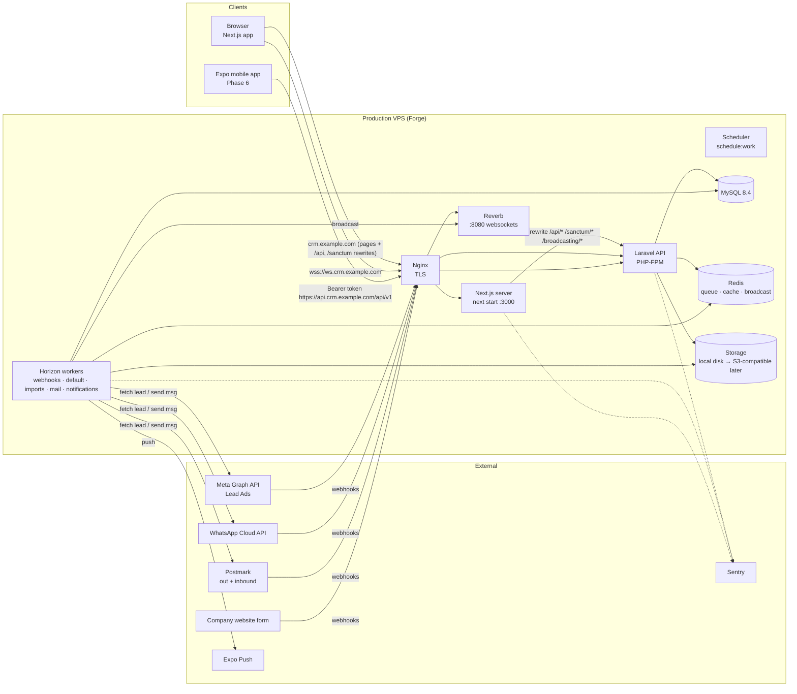
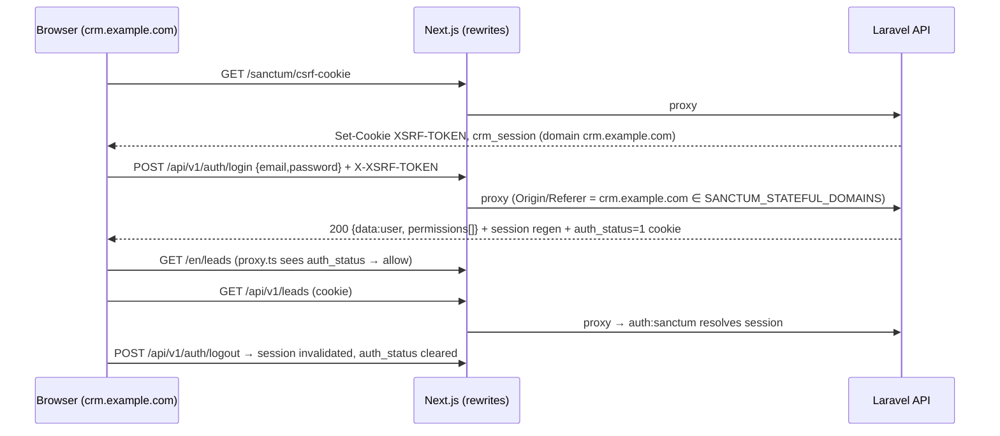
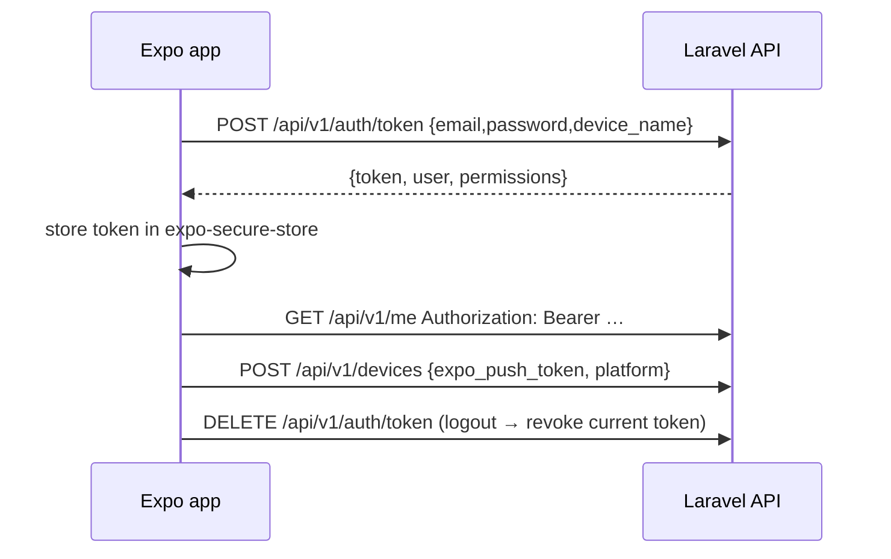
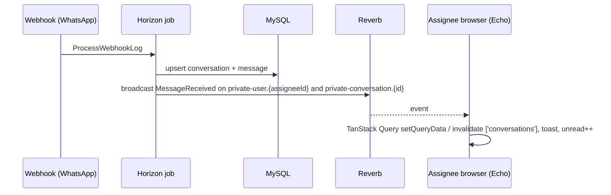
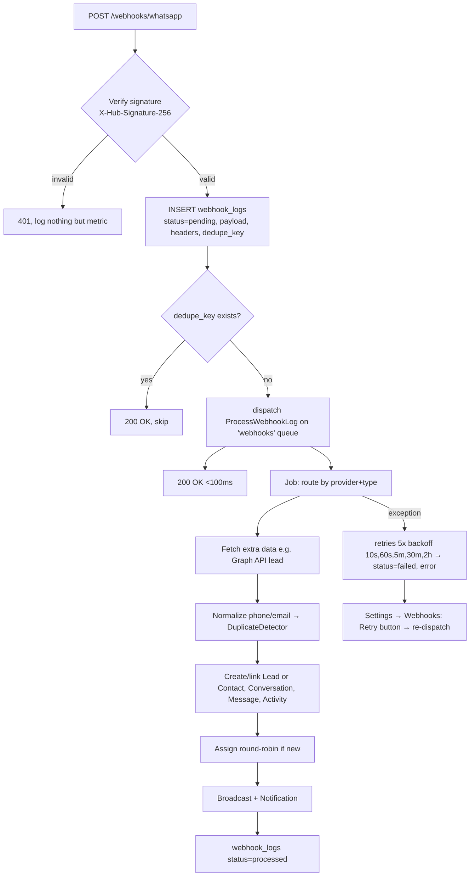

# 01 — Architecture

## System diagram



## Repo structure

```
/                     CLAUDE.md, README.md, SETUP.md, .github/workflows/, docker-compose.yml (Sail)
backend/              Laravel 13 API
frontend/             Next.js 16 web app
mobile/               Expo app (Phase 6)
docs/                 00–09 plan docs, PLAN.md, RISKS.md, DECISIONS.md, legacy template docs
```

## Backend folder structure (target)

```
backend/app/
  Actions/                 single-purpose business operations (ConvertLead, MoveDealToStage, AssignLeadRoundRobin…)
  Enums/                   LeadStatus, StageType, ActivityType, TaskPriority, Channel, MessageStatus, QuoteStatus…
  Events/                  LeadCreated, DealStageChanged, MessageReceived… (ShouldBroadcast where realtime)
  Exceptions/              ApiExceptionRenderer (existing), DomainException subclasses
  Http/
    Controllers/Api/V1/    one controller per resource (+ invokable for actions)
    Controllers/Webhooks/  FacebookWebhookController, WhatsAppWebhookController, PostmarkInboundController, WebsiteFormController
    Middleware/            SetLocale (existing), VerifyMetaSignature, VerifyPostmarkBasicAuth, VerifyFormApiKey
    Requests/V1/<Module>/  Store/Update/Index (filters) requests
    Resources/V1/          API Resources
  Integrations/
    Meta/                  GraphClient, LeadAdsService, WhatsAppClient, TemplateSync
    Email/                 InboundEmailParser (interface) + PostmarkInboundParser, ThreadResolver
  Jobs/                    ProcessWebhookLog, FetchFacebookLead, ImportLeadsChunk, SendWhatsAppMessage, SendTaskReminder…
  Listeners/
  Models/                  + Concerns/ (HasVisibilityScope, HasCustomFields, HasTimeline, Taggable, NormalizesContactInfo)
  Notifications/
  Policies/
  Providers/
  Services/                DuplicateDetector, PhoneNormalizer, MoneyFormatter, ReportQuery…
  Support/                 HasTranslations (existing), Visibility (scope builder), Envelope helpers
backend/routes/
  api.php                  `/api/v1/*` (prefix applied in bootstrap/app.php)
  webhooks.php             `/webhooks/*` (no auth, signature middleware, no CSRF)
  channels.php             broadcast channel auth
  console.php              schedule
backend/tests/
  Feature/<Module>/        per-endpoint + per-role tests
  Unit/                    services, actions
  Pest.php, Datasets/roles.php
```

## Frontend folder structure (target)

```
frontend/src/
  app/
    [locale]/
      (auth)/login, forgot-password, reset-password     ← public, split-screen layout
      (app)/layout.tsx                                   ← AppShell (sidebar + topbar), auth guard
      (app)/dashboard, leads, leads/[id], contacts, contacts/[id], companies, companies/[id],
            deals (board|list), deals/[id], tasks, inbox, inbox/[conversationId], quotes, quotes/[id],
            reports, notifications, settings/{profile,users,teams,roles,pipelines,lead-sources,
            lost-reasons,products,templates,custom-fields,tags,integrations,webhooks,audit}
      dev/design                                         ← design-system playground (dev only)
    layout.tsx                                           ← minimal root (fonts)
  components/
    ui/          shadcn primitives (restyled)
    crm/         StatusPill, StageChip, Money, DataTable, KanbanBoard… (see 09-design-system §8)
    shell/       AppSidebar, Topbar, CommandPalette, NotificationBell, LocaleSwitcher, ThemeToggle
    forms/       field components bound to react-hook-form
  features/<module>/   api.ts (query/mutation hooks), schema.ts (zod), columns.tsx, components/
  lib/
    api/         client.ts (openapi-fetch + CSRF + errors), schema.d.ts (GENERATED), query-keys.ts
    echo.ts      Laravel Echo setup
    design/      semantic.ts (domain → token map)
    format.ts    money, date, phone (Intl)
  i18n/          routing.ts, request.ts, navigation.ts
  messages/      ar.json, en.json
  proxy.ts       next-intl middleware + auth redirect (Next 16 `proxy` convention)
```

## Auth flows

### Web (Sanctum SPA cookie via same-origin rewrites)



- `auth_status` is a UX hint for `proxy.ts` redirects only; **every API call is authorized server-side**.
- Session lifetime 8h sliding; "remember me" 30 days.
- Login throttled 5/min per email+IP; lockout notice translated.

### Mobile (Phase 6, Sanctum tokens)



Tokens: abilities `["mobile"]`, expiry 90 days, listed + revocable in Settings → Profile → Devices.

## Realtime flow



Channels (`routes/channels.php`):
- `private-user.{id}` — notifications, assignment events (only that user).
- `private-team.{id}` — Kanban updates (`DealMoved`, `DealUpdated`) for team members & managers.
- `private-pipeline.{id}` — board-level updates for admins/view_all.
- `private-conversation.{id}` — messages + status ticks; authorized via ConversationPolicy@view.

Echo `authorizer` posts to `/broadcasting/auth` through the Next rewrite (same-origin cookie). Client ignores events it caused (`X-Socket-ID` header → `->toOthers()`).

## Queue / webhook flow



## Environments

| Env | Web | API | DB | Mail | Meta |
|---|---|---|---|---|---|
| local | `localhost:3000` | `localhost:8000` (Sail) | Sail MySQL | Mailpit `:8025` | Meta test app + ngrok/cloudflared tunnel for webhooks |
| staging | `staging.crm.<co>` | `api.staging.crm.<co>` | separate DB on staging VPS | Postmark sandbox server | Meta app in dev mode, test page & WA test number |
| production | `crm.<co>` | `api.crm.<co>` | prod MySQL, nightly backups offsite | Postmark live | Live app, verified business, real number |

Config via `.env` only; `config:cache` in staging/prod. Feature flags in `config/crm.php` (`features.inbox`, `features.facebook`, …) so unfinished integrations can ship dark.
