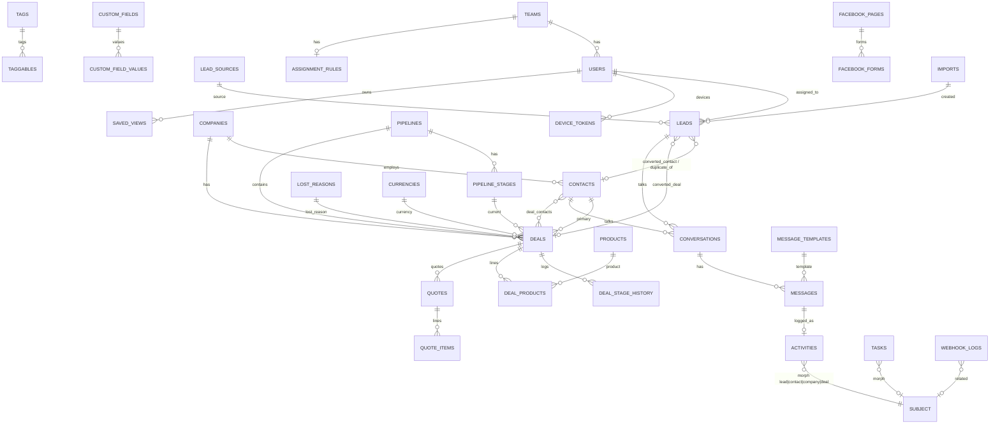

# 02 — Database

MySQL 8.4, `utf8mb4_0900_ai_ci` (correct Arabic collation & case-insensitive search). All times stored UTC (`timestamp`), displayed in company timezone.

## Conventions

- PK `id` BIGINT UNSIGNED auto-increment. `ulid` CHAR(26) unique only where noted (ADR-018).
- FK naming `<thing>_id`; `assigned_to`, `created_by`, `team_id` reference `users`/`teams` with `ON DELETE SET NULL` (users are deactivated, not deleted).
- **Business entities** (`leads, companies, contacts, deals, activities, tasks, quotes, products, conversations`) have `softDeletes()`.
- **Scoping columns** `assigned_to` + `team_id` on: leads, companies, contacts, deals, activities, tasks, conversations, quotes (ADR-004/009). `team_id` is copied from the assignee at assignment time (job keeps it in sync on reassignment / team change).
- Money: `*_minor` BIGINT + `currency` CHAR(3) (ADR-007). Percentages as basis points `*_bp` SMALLINT (1500 = 15%).
- Translatable lookups: `name_ar`, `name_en` VARCHAR(120) — both required (brief). User-entered free text is single-language.
- Enums: VARCHAR(32) + PHP backed enum cast (no MySQL ENUM — painless to extend).
- `last_activity_at` on leads/contacts/companies/deals, updated by `ActivityObserver` (sorting "stale" records).

## Tables

### Identity & org

**users** (existing, altered)
| column | type | notes |
|---|---|---|
| id | bigint PK | |
| name | varchar(120) | |
| email | varchar(191) unique | |
| password | varchar | |
| phone | varchar(32) null | |
| job_title | varchar(120) null | |
| team_id | FK teams null | idx |
| locale | varchar(5) default 'ar' | existing |
| timezone | varchar(64) null | override company tz |
| is_active | bool default true | idx; inactive cannot log in, excluded from round-robin |
| receives_leads | bool default true | round-robin pool |
| is_away | bool default false | temporary skip in round-robin |
| preferences | json null | density, sidebar, table columns |
| last_seen_at | timestamp null | |
| two_factor_secret / two_factor_recovery_codes / two_factor_confirmed_at | text null / text null / ts null | Phase 5 |
| email_verified_at, remember_token, timestamps | | existing |

**teams**: id, name_ar, name_en, manager_id FK users null, timestamps. 
**assignment_rules**: id, team_id FK unique, strategy varchar (`round_robin`|`manual`), last_assigned_user_id FK users null, is_active bool, timestamps.
**Spatie permission tables** (existing): roles, permissions, model_has_roles, model_has_permissions, role_has_permissions.
**personal_access_tokens** (existing). **device_tokens** (Phase 6): id, user_id FK cascade, token varchar(255) unique, platform varchar(16), last_used_at, timestamps.

### Lookups

**lead_sources**: id, key varchar(32) unique (`facebook, whatsapp, email, website, manual, import` + custom), name_ar, name_en, is_system bool, is_active bool, sort_order smallint, timestamps.
**lost_reasons**: id, name_ar, name_en, is_active, sort_order, timestamps.
**currencies**: code CHAR(3) PK, exponent tinyint (2; KWD/BHD/OMR/JOD = 3), name_ar, name_en, rate_to_default DECIMAL(18,8), is_active, timestamps.
**tags**: id, name varchar(60) unique, color varchar(16) (palette key), timestamps. **taggables**: tag_id FK cascade, taggable_type, taggable_id; PK(tag_id, taggable_type, taggable_id); idx(taggable_type, taggable_id).
**custom_fields**: id, entity varchar(16) (`lead|contact|company|deal`), key varchar(64), label_ar, label_en, type varchar(16) (`text|textarea|number|date|select|multiselect|boolean|url|phone|email`), options json null `[{value,label_ar,label_en}]`, is_required, is_active, show_in_table, sort_order, timestamps; unique(entity, key).
**custom_field_values**: id, custom_field_id FK cascade, entity_type, entity_id, value_text varchar(1000) null, value_number DECIMAL(20,4) null, value_date date null, value_bool bool null, value_json json null, timestamps; unique(custom_field_id, entity_type, entity_id); idx(custom_field_id, value_text(100)), idx(custom_field_id, value_number), idx(custom_field_id, value_date).
**app_settings**: key varchar(64) PK, value json, updated_by FK users null, timestamps — company name, timezone, default currency/country, working days, logo (media).
**saved_views**: id, user_id FK cascade, entity varchar(16), name, filters json, columns json, sort json, is_shared bool, timestamps.

### Leads

**leads**
| column | type | notes |
|---|---|---|
| id, ulid | | ulid for public refs |
| first_name, last_name | varchar(100) / null | |
| company_name, job_title | varchar(150) null | |
| email | varchar(191) null | |
| email_normalized | varchar(191) null | idx |
| phone | varchar(32) null | as entered |
| phone_e164 | varchar(20) null | idx |
| status | varchar(32) | `new|contacted|qualified|unqualified|converted`; idx(status) |
| lead_source_id | FK lead_sources | idx |
| source_detail | varchar(191) null | campaign/form name, referrer |
| external_id | varchar(100) null | FB `leadgen_id`, WA message id… unique(lead_source_id, external_id) |
| external_meta | json null | campaign_id, ad_id, form_id, page_id, utm_* |
| raw_payload | json null | original mapped data |
| notes | text null | |
| unqualified_reason | varchar(255) null | |
| duplicate_of_lead_id | FK leads null | |
| duplicate_of_contact_id | FK contacts null | |
| assigned_to | FK users null | idx(assigned_to, status) |
| team_id | FK teams null | idx(team_id, status) |
| created_by | FK users null | null = system |
| converted_at, converted_by | ts / FK users null | |
| converted_contact_id / converted_company_id / converted_deal_id | FK null | |
| import_id | FK imports null | |
| last_activity_at | ts null | idx |
| timestamps, deleted_at | | idx(created_at) |

Full-text: `FULLTEXT(first_name, last_name, company_name, email) WITH PARSER ngram` (Arabic tokenization) for global search.

### Accounts

**companies**: id, name varchar(191) idx, domain varchar(191) null idx, industry varchar(100) null, size varchar(32) null, phone, phone_e164 idx, email, email_normalized, website, country_code char(2) null, city, address text null, tax_number varchar(64) null, is_customer bool default false idx, customer_since date null, assigned_to, team_id, created_by, last_activity_at, timestamps, deleted_at. FULLTEXT ngram(name, domain).

**contacts**: id, company_id FK null (set null) idx, first_name, last_name, job_title, email, email_normalized idx, phone, phone_e164 idx, whatsapp_e164 null idx, preferred_locale varchar(2) default 'ar', preferred_channel varchar(16) null, lead_source_id FK null, origin_lead_id FK leads null, is_customer bool idx, customer_since date null, assigned_to, team_id, created_by, last_activity_at, timestamps, deleted_at. FULLTEXT ngram(first_name, last_name, email).

### Pipeline & deals

**pipelines**: id, name_ar, name_en, is_default bool, is_active bool, sort_order, timestamps.
**pipeline_stages**: id, pipeline_id FK cascade, name_ar, name_en, sort_order smallint, color varchar(16) palette key, probability tinyint (0–100), type varchar(8) `open|won|lost`, rotting_days smallint null, timestamps; idx(pipeline_id, sort_order). Constraint (app-level): exactly one `won` and one `lost` stage per pipeline.

**deals**
| column | type | notes |
|---|---|---|
| id, title | | |
| pipeline_id, stage_id | FK | idx(pipeline_id, stage_id, position) |
| status | varchar(8) | denormalized from stage.type: `open|won|lost`; idx(status, closed_at) |
| position | int | order within stage column (gaps of 1024, rebalance job) |
| company_id, contact_id | FK null | primary contact |
| lead_id | FK null | origin |
| amount_minor | bigint default 0 | |
| currency | char(3) FK currencies | |
| probability | tinyint null | override; null → stage probability |
| expected_close_date | date null | idx |
| closed_at | ts null | |
| lost_reason_id | FK null | required when status=lost |
| lost_note | text null | |
| stage_entered_at | ts | rotting indicator |
| lock_version | int unsigned default 0 | optimistic locking (ADR-025) |
| assigned_to, team_id, created_by, last_activity_at, timestamps, deleted_at | | idx(assigned_to,status), idx(team_id,status) |

**deal_contacts**: deal_id, contact_id, role varchar(64) null; PK(deal_id, contact_id).
**deal_stage_history**: id, deal_id FK cascade, from_stage_id FK null, to_stage_id FK, changed_by FK users null, changed_at ts, seconds_in_previous int unsigned null, amount_minor bigint (snapshot), currency; idx(deal_id, changed_at), idx(to_stage_id, changed_at).

### Products & quotes (Phase 4)

**products**: id, sku varchar(64) unique null, name_ar, name_en, description_ar, description_en (text null), billing_type varchar(16) `one_time|monthly|yearly`, price_minor, currency, tax_rate_bp smallint default 1500, is_active, timestamps, deleted_at.
**deal_products**: id, deal_id FK cascade, product_id FK null, name varchar(191) snapshot, billing_type, quantity DECIMAL(10,2), unit_price_minor, discount_bp, tax_rate_bp, total_minor, sort_order, timestamps.
**quotes**: id, ulid, number varchar(32) unique (`Q-2026-0001`), deal_id FK, company_id, contact_id, locale varchar(2), status varchar(16) `draft|sent|accepted|rejected|expired`, issue_date, valid_until, currency, subtotal_minor, discount_minor, tax_minor, total_minor, notes text null, terms text null, sent_at, accepted_at, rejected_at, assigned_to, team_id, created_by, timestamps, deleted_at; idx(deal_id), idx(status).
**quote_items**: id, quote_id FK cascade, product_id FK null, name, description text null, billing_type, quantity, unit_price_minor, discount_bp, tax_rate_bp, total_minor, sort_order.
**quote_sequences**: year smallint PK, last_number int (row-locked when issuing).

### Activities & tasks

**activities**: id, type varchar(32) (`call|meeting|note|email|whatsapp|stage_change|status_change|assignment|system`), subject_type, subject_id (morph: lead|contact|company|deal), contact_id FK null, company_id FK null (denormalized for timeline roll-up), user_id FK null (author), title varchar(191) null, body text null, direction varchar(3) null (`in|out`), outcome varchar(32) null (call: answered/no_answer/busy…), duration_seconds int null, occurred_at ts, message_id FK messages null, meta json null, assigned_to, team_id, timestamps, deleted_at; idx(subject_type, subject_id, occurred_at), idx(contact_id, occurred_at), idx(company_id, occurred_at), idx(user_id, occurred_at).

**tasks**: id, title, description text null, taskable_type/taskable_id null (morph), priority varchar(8) `low|medium|high`, status varchar(12) `open|done|cancelled`, due_at ts null, remind_at ts null, reminded_at ts null, completed_at, completed_by, assigned_to, team_id, created_by, timestamps, deleted_at; idx(assigned_to, status, due_at), idx(remind_at, reminded_at), idx(taskable_type, taskable_id).

### Inbox (Phase 3)

**conversations**: id, channel varchar(16) `whatsapp|email`, thread_key varchar(255) (WA: customer E.164; email: root Message-ID), contact_id FK null, lead_id FK null, subject varchar(255) null, status varchar(8) `open|closed`, last_message_at, last_inbound_at (24h window), assigned_to, team_id, timestamps, deleted_at; unique(channel, thread_key); idx(assigned_to, last_message_at).
**conversation_reads**: conversation_id, user_id, last_read_message_id, read_at; PK(conversation_id, user_id). Unread = messages after `last_read_message_id`.
**messages**: id, conversation_id FK cascade, direction `in|out`, type `text|image|document|audio|video|template|email|system`, body text null, body_html mediumtext null, subject null, from_address, to_addresses json, cc json null, external_id varchar(255) null unique (wamid / Message-ID), in_reply_to varchar(255) null, references_header text null, message_template_id FK null, template_params json null, status varchar(12) `queued|sent|delivered|read|failed|received`, error_code, error_message, sent_by FK users null, sent_at, delivered_at, read_at, meta json, timestamps; idx(conversation_id, id).
**message_templates**: id, channel, name varchar(120), language varchar(10), category varchar(32) null, status varchar(16) `approved|pending|rejected|local`, external_id null, components json (WA) , subject_ar/subject_en/body_ar/body_en (email templates), variables json, last_synced_at, timestamps; unique(channel, name, language).

### Integrations & system

**integration_settings**: id, provider varchar(32), key varchar(64), value text (**`encrypted` cast**), updated_by, timestamps; unique(provider, key).
**facebook_pages**: id, page_id varchar(64) unique, name, access_token text encrypted, is_subscribed bool, subscribed_at, timestamps.
**facebook_forms**: id, facebook_page_id FK, form_id varchar(64) unique, name, field_mapping json, default_team_id FK null, is_active, timestamps.
**form_keys** (website form): id, name, key_prefix char(8) idx, key_hash varchar(255), allowed_origins json null, default_team_id null, lead_source_id, is_active, last_used_at, timestamps.
**webhook_logs**: id, ulid, provider varchar(32), event_type varchar(64) null, dedupe_key varchar(191) unique null, headers json, payload json, signature_valid bool, status `pending|processing|processed|failed|ignored`, attempts tinyint, error text null, processed_at, related_type/related_id null, timestamps; idx(provider, status, created_at). Pruned after 90 days (processed) / 365 (failed).
**imports**: id, user_id, entity `leads`, status `pending|mapping|validating|processing|completed|failed`, original_name, mapping json, options json (source, team, assignee, dedupe policy `skip|link|create`), total_rows, processed_rows, created_rows, duplicate_rows, failed_rows, started_at, finished_at, timestamps. File + error report stored as media on the import.
**media** (existing medialibrary) — attachments on leads/contacts/companies/deals/messages/quotes/imports.
**notifications** (Laravel, uuid PK).
**activity_log** (spatie activitylog) — audit.
**jobs / failed_jobs / job_batches / cache / sessions** — Laravel defaults (sessions in Redis in prod).

## ER diagram

## Migration order

Phase 1: `alter_users_add_crm_columns` → `teams` → `add_team_fk_to_users` → `assignment_rules` → permission seed changes (no schema) → `lead_sources` → `lost_reasons` → `currencies` → `tags`/`taggables` → `custom_fields`/`custom_field_values` → `saved_views` → `activity_log` (spatie publish) → `pipelines` → `pipeline_stages`.
Phase 2: `companies` → `contacts` → `imports` → `leads` (FKs to contacts/companies added after deals: see next) → `deals` → `deal_contacts` → `deal_stage_history` → `add_conversion_fks_to_leads` → `activities` → `tasks` → `notifications`.
Phase 3: `webhook_logs` → `integration_settings` → `conversations` → `conversation_reads` → `messages` → `message_templates` → `add_message_fk_to_activities` → `facebook_pages` → `facebook_forms` → `form_keys`.
Phase 4: `products` → `deal_products` → `quote_sequences` → `quotes` → `quote_items`.
Phase 6: `device_tokens`.
Cleanup (step 2.3): `drop_posts_table`.

## Seeders

| Seeder | Env | Content |
|---|---|---|
| `RolePermissionSeeder` | all | roles + permissions (06-security matrix), idempotent `firstOrCreate`, syncs role perms |
| `LookupSeeder` | all | lead sources (6 system), lost reasons (Price too high / السعر مرتفع, Chose competitor / اختار منافساً, No budget / لا توجد ميزانية, No response / لا يوجد رد, Not a fit / غير مناسب, Timing / التوقيت غير مناسب), currencies (USD, SAR, AED, EUR, JOD, KWD, EGP), default pipeline "New Sales / مبيعات جديدة" with 8 stages (probabilities 10/20/40/60/70/80/100/0) |
| `AdminUserSeeder` | all | first admin from `ADMIN_EMAIL`/`ADMIN_PASSWORD` env (no hard-coded password) |
| `DemoSeeder` | local, staging | 2 teams (Riyadh Sales / مبيعات الرياض, Enterprise / الشركات الكبرى), 1 admin, 2 managers, 10 reps, 2 support; 40 companies, 120 contacts, 300 leads (mixed sources, statuses, ~5% duplicates), 150 deals across stages, 1,000 activities, 200 tasks (some overdue), 30 conversations (Phase 3), 20 quotes (Phase 4). Names: ~60% Arabic (`fake('ar_SA')`), 40% English; phone numbers +966/+971/+962 valid formats |

Factories exist for every model and are the only source of test data.
