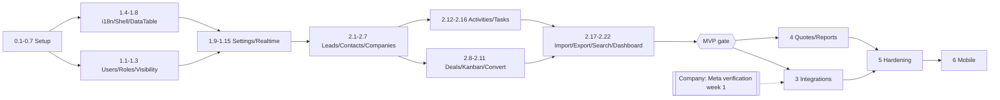

# PLAN — CRM master implementation plan

Read first: `00-overview.md` (scope, assumptions, company checklist) · `DECISIONS.md` · `09-design-system.md`.

## How to use this plan

- Steps are numbered `P.N`. Each step is **one PR** and lists: Goal · Depends on · Backend · Frontend · Files · Commands · Tests · Acceptance · Estimate.
- Each step is split into **sub-tasks (`a`, `b`, `c`…) of 1–4 h** that each end in something runnable (a passing test, a page that renders, a command that succeeds). Commit per sub-task.
- `‖` = can run in parallel with the listed steps (no shared files/blocking dependency). `⛔` = blocks the listed steps.
- "Definition of done" for every step: CI green · tests listed written · both locales checked (screenshots in PR for UI) · docs touched if behavior changed · `CLAUDE.md` rules followed.
- Estimates are focused solo-developer hours; phase durations add ~25% buffer for review, bugs, company delays.
- Commands assume Sail: `sail` = `./vendor/bin/sail` from `backend/` (alias it). Frontend commands run in `frontend/`.

## Phase overview

| Phase | Goal | Exit criteria | Est. (solo) |
|---|---|---|---|
| **0 Setup** | Modern toolchain, design system tokens, CI, `/api/v1` + typed client, staging online | `sail up` works; CI green on PR; design playground renders both themes × dirs; staging URL serves login | 1.5 weeks |
| **1 Foundation** | Auth/roles/visibility, i18n routing + RTL, app shell, settings for org & lookups, realtime + notifications base | Admin can create users/teams/roles, configure pipeline, sources, lost reasons, custom fields in AR & EN; rep sees only shell items they're allowed; realtime test notification arrives | 3 weeks |
| **2 Core CRM MVP** | Leads, contacts, companies, deals + Kanban, activities, tasks, import/export, search, basic dashboard | Full lead → convert → deal → won flow by every role per matrix, E2E suite green, demo data loaded on staging | 6 weeks |
| **🚩 MVP demo gate** | Demo to company; collect feedback; reprioritise | Sign-off list; change requests triaged into Phase 3+ or backlog | 2 days |
| **3 Integrations & Inbox** | Webhook pipeline, website form, Facebook Lead Ads, WhatsApp, email, unified inbox | Real leads from FB test tool & website create assigned leads in < 10 s; WA & email two-way in inbox with realtime; failed webhooks retryable | 5 weeks (calendar-bound by Meta approvals) |
| **4 Quotes, dashboard, reports** | Products, deal products, quotes + AR/EN PDF + send, reports & dashboard, exports | Quote PDF correct in Arabic & English, sent and tracked; reports match seeded fixtures exactly | 3.5 weeks |
| **5 Hardening & web launch** | Security, performance, a11y/RTL audit, prod infra, backups, monitoring, data migration, UAT | Pen-test checklist passed; restore drill done; UAT sign-off; production live | 3 weeks |
| **6 Mobile app** | Expo field-sales companion on same API | Internal TestFlight/Play internal track used by reps for 1 week without blockers | 5 weeks |
| **🚩 Mobile release gate** | Store submission | Approved in App Store + Play | 1 week (review time) |

Total ≈ 27 weeks solo incl. buffer.

## Critical path & parallelism

Phase 3 and Phase 4 are independent → order can swap if Meta approvals lag (recommended: start 4.1–4.6 while waiting on App Review).

---

# Phase 0 — Setup (≈ 1.5 weeks)

### 0.0 Company kickoff (non-dev, day 1)
- **Goal:** start long-lead items now.
- **Tasks:** send `00-overview.md → Company must provide` list; owners + dates agreed; Meta Business verification submitted; WA number chosen; domains & VPS budget approved; answers to Q1–Q10.
- **Acceptance:** written confirmation with dates. **Estimate:** 2 h. ‖ everything.

### 0.1 Local Docker environment (Sail)
- **Goal:** reproducible PHP 8.4 / MySQL 8.4 / Redis / Mailpit stack (local PHP 8.2 is too old for Laravel 13).
- **Depends on:** — · ⛔ 0.2+
- **Backend:** a) install Docker Desktop (WSL2 backend; enable VT-x in BIOS + Virtual Machine Platform); repo stays on the Windows drive (ADR-027). b) `php artisan sail:install --with=mysql,redis,mailpit --php=8.4`; `backend/sail` wrapper because `vendor/bin/sail` rejects Git Bash. c) `.env.example` → MySQL/Redis/Mailpit defaults, ports 8000/3307 to coexist with XAMPP; `composer dev` (native: serve + queue + pail) and `composer workers` (under Sail: queue + pail).
- **Files:** `backend/compose.yaml`, `backend/sail`, `backend/.env.example`, `backend/phpunit.xml` (MySQL `testing` DB), `backend/composer.json` scripts, `SETUP.md` (local section rewritten), `README.md` quick start.
- **Commands:** `sail up -d`, `sail artisan migrate --seed`, `sail artisan test`.
- **Tests:** existing example tests pass on MySQL.
- **Acceptance:** fresh clone → `sail up -d && sail artisan migrate --seed` → `http://localhost:8000/up` 200; frontend logs in with seeded user against it; Mailpit UI on :8025 receives password-reset mail.
- **Estimate:** 4 h.

### 0.2 Upgrade backend to Laravel 13 & current packages
- **Goal:** start on latest stable versions (checked 2026-11-09: laravel/framework 13.40, permission 8.5).
- **Depends on:** 0.1
- **Backend:** a) follow official 12→13 upgrade guide; `composer.json` `php: ^8.3`, `laravel/framework: ^13.0`, bump sanctum/tinker/medialibrary/permission (read spatie permission v7+v8 upgrade notes — config & migration changes). b) fix breaking changes; publish any new config. c) run app + tests.
- **Files:** `backend/composer.json`, `composer.lock`, `config/*`, possibly `bootstrap/app.php`.
- **Commands:** `sail composer update`, `sail artisan about`.
- **Tests:** existing tests + manual login/logout/avatar/password reset.
- **Acceptance:** `sail artisan about` shows Laravel 13.x, PHP 8.4; all existing flows work from the frontend.
- **Estimate:** 4 h.

### 0.3 Backend quality tooling (Pest, Larastan, Pint, arch tests)
- **Depends on:** 0.2 · ‖ 0.4, 0.5
- **Backend:** a) `composer require pestphp/pest --dev -W`, `pest --init`, convert `tests/Feature/ExampleTest.php`/`Unit` to Pest; configure MySQL testing DB (`phpunit.xml` → `DB_DATABASE=testing`, Sail creates it). b) `larastan/larastan` level 6 + `phpstan.neon` baseline; `pint.json` (Laravel preset). c) `tests/Arch.php` (no debug functions, strict types, no `env()` outside config). d) composer scripts `lint`, `analyse`, `test`, `check` (all three).
- **Files:** `backend/tests/Pest.php`, `tests/Arch.php`, `phpstan.neon`, `pint.json`, `composer.json` scripts.
- **Commands:** `sail composer check`.
- **Tests:** existing behavior covered by Pest auth tests: login ok/fail/throttle, logout, `/user`, password reset (write them now — the template has none).
- **Acceptance:** `composer check` green locally.
- **Estimate:** 4 h.

### 0.4 Frontend tooling (versions, Vitest, Playwright skeleton, lint)
- **Depends on:** — · ‖ 0.1–0.3
- **Frontend:** a) bump `next`/`eslint-config-next` to latest 16.x, react, deps; read Next 16 upgrade notes in `node_modules/next/dist/docs`. b) Vitest + Testing Library + jsdom + MSW; `npm run test`. c) Playwright init (`e2e/`), one login smoke test (skipped in CI until 0.6 provides backend). d) scripts `typecheck`, `lint`, `test`, `e2e`; Prettier with `prettier-plugin-tailwindcss`.
- **Files:** `frontend/package.json`, `vitest.config.ts`, `playwright.config.ts`, `e2e/auth.spec.ts`, `.prettierrc`.
- **Commands:** `npm run typecheck && npm run lint && npm run test && npm run build`.
- **Tests:** unit test for `lib/form-errors.ts applyServerErrors`.
- **Acceptance:** all scripts pass; build works.
- **Estimate:** 3 h.

### 0.5 Design system foundation (tokens, fonts, playground)
- **Goal:** apply `09-design-system.md` before any CRM screen exists.
- **Depends on:** 0.4 · ⛔ 1.6, 1.7
- **Frontend:** a) replace `:root`/`.dark`/prefers-color-scheme blocks in `globals.css` with §2.1 tokens; extend `@theme inline` (§2.2); `@utility tint-*`. b) fonts: IBM Plex Sans, Plex Sans Arabic, Plex Mono via `next/font/google`; `:lang(ar)` line-height; tabular-nums utility. c) restyle shadcn Button (add `highlight` variant), Badge, Input, Table, Sonner to tokens/radius scale; add missing primitives via `npx shadcn add` (dialog, sheet, popover, tooltip, tabs, badge, avatar, skeleton, command, calendar, switch, alert-dialog, scroll-area, separator). d) `src/lib/design/semantic.ts` (domain→token map from §2.3) + `StatusPill`, `StageChip`, `SourceBadge`, `DirIcon`. e) `/dev/design` page (404 in production): color tokens, type scale, buttons, inputs, pills, chips, both themes, `dir` toggle. f) lint: forbid hex/`oklch(` literals in `.tsx`.
- **Files:** `frontend/src/app/globals.css`, `src/app/layout.tsx` (fonts), `src/components/ui/*`, `src/components/crm/{status-pill,stage-chip,source-badge}.tsx`, `src/components/dir-icon.tsx`, `src/lib/design/semantic.ts`, `src/app/dev/design/page.tsx`, `eslint.config.mjs`.
- **Commands:** `npx shadcn@latest add …`, `npm run dev`.
- **Tests:** Vitest: `semantic.ts` maps every enum value (exhaustive check); StatusPill renders icon + label.
- **Acceptance:** playground shows all tokens in light/dark × LTR/RTL; contrast spot-check with browser devtools matches §2 table; existing pages still work and look on-brand.
- **Estimate:** 8 h (a 2h, b 1h, c 2h, d 1.5h, e 1.5h).

### 0.6 CI (GitHub Actions)
- **Depends on:** 0.3, 0.4 · ⛔ every later PR
- **Tasks:** a) `.github/workflows/ci.yml` backend job (MySQL 8.4 + Redis services, composer cache, pint --test, phpstan, pest --parallel). b) frontend job (npm ci, lint, typecheck, vitest, build). c) e2e job (Sail compose up, seed, `next start`, Playwright) — initially the login smoke. d) branch protection on `main`; Dependabot config.
- **Files:** `.github/workflows/ci.yml`, `.github/dependabot.yml`.
- **Acceptance:** PR shows 3 green checks; deliberately broken test makes CI red.
- **Estimate:** 4 h.

### 0.7 API v1, response envelope, Scramble + typed client
- **Depends on:** 0.3, 0.4 · ⛔ all API work
- **Backend:** a) `bootstrap/app.php` API prefix `api/v1`; move existing routes; remove `/register` (+ request/test/frontend page). b) extend `ApiExceptionRenderer` with `code` field & mapping table (03-api); `DomainException` base class → 422 `domain_error`. c) `composer require dedoc/scramble`; config (title, servers, auth: cookie + bearer); `composer api:spec` → `../frontend/openapi.json`. d) remove spatie/laravel-typescript-transformer + `app/TypeScript/*` once frontend switched (sub-task f).
- **Frontend:** e) `openapi-typescript` + `openapi-fetch`; `src/lib/api/client.ts` (CSRF bootstrap, credentials include, `Accept-Language`, error → `ApiError` with `code`); `npm run api:types`. f) migrate `auth-context`, posts, admin users, avatar, locale calls to new client; delete `types/generated.ts`.
- **Files:** `backend/bootstrap/app.php`, `routes/api.php`, `app/Exceptions/ApiExceptionRenderer.php`, `app/Exceptions/DomainException.php`, `config/scramble.php`, `composer.json`; `frontend/openapi.json`, `src/lib/api/{client.ts,schema.d.ts,errors.ts}`, updated callers; `docs/api-error-handling.md` updated.
- **Commands:** `sail composer api:spec && npm run api:types`.
- **Tests:** Pest: error envelope per status (401/403/404/422/409/429/500 with `code`); `/api/register` 404. Vitest: client maps 422 → `ApiError.errors`. CI: schema drift check added.
- **Acceptance:** `/docs/api` lists endpoints; frontend compiles against generated types; login/logout still work.
- **Estimate:** 8 h.

### 0.8 Staging server & first deploy
- **Depends on:** 0.6, company: domain + VPS (0.0) · ‖ Phase 1 (do when infra ready)
- **Tasks:** a) Forge server (08-deployment), sites api/web/ws (ws placeholder), TLS. b) env files, deploy scripts (backend + frontend standalone), Supervisor for Next. c) `main` auto-deploys to staging; GitHub Environment `staging`. d) `ADMIN_EMAIL` seeding.
- **Files:** `frontend/next.config.ts` (`output: "standalone"`), `docs/08-deployment.md` (actual values), `deploy/` scripts.
- **Acceptance:** `https://staging.crm.<co>` login works over HTTPS, cookies `Secure`, rewrites hit API.
- **Estimate:** 6 h (+ waiting on DNS).

---

# Phase 1 — Foundation (≈ 3 weeks)

### 1.1 Teams & CRM user fields
- **Depends on:** 0.7 · ‖ 1.4
- **Backend:** a) migrations `alter_users_add_crm_columns` (phone, job_title, team_id, timezone, is_active, receives_leads, is_away, preferences, last_seen_at), `teams`, `assignment_rules`. b) models `Team`, `AssignmentRule`; `User` relations/casts; `EnsureUserIsActive` middleware in api group. c) factories.
- **Files:** `database/migrations/*`, `app/Models/{Team,AssignmentRule,User}.php`, `app/Http/Middleware/EnsureUserIsActive.php`, `database/factories/*`.
- **Tests:** inactive user gets 401 + session killed; factory states (`manager()`, `rep()`, `inTeam()`).
- **Acceptance:** `sail artisan migrate:fresh --seed` clean.
- **Estimate:** 3 h.

### 1.2 Permission catalogue, roles, `/me`, `can` blocks
- **Depends on:** 1.1
- **Backend:** a) `App\Enums\Permission` (all permissions in 06-security) + `RolePermissionSeeder` idempotent sync for admin/manager/rep/support; remove template `user` role & `manage-users` (map to `users.manage`). b) `GET/PATCH /me` (+ `/me/password`, `/me/away`), `MeResource` with roles, flat `permissions[]`, team. c) `AuthorizesWithCanBlock` concern for Resources (`can` object from Policy abilities). d) `Gate::before` admin bypass retained.
- **Frontend:** e) `useMe()` query replaces `auth-context` user fetch; `usePermission('leads.assign')` + `<Can permission="…">` helper.
- **Files:** `app/Enums/Permission.php`, `database/seeders/RolePermissionSeeder.php`, `app/Http/Controllers/Api/V1/MeController.php`, `app/Http/Requests/V1/Me/*`, `app/Http/Resources/V1/MeResource.php`; `frontend/src/features/me/*`, `src/components/can.tsx`.
- **Tests:** seeder idempotent (run twice, same counts); each role has exactly the matrix permissions (snapshot test against 06-security table encoded in a dataset); `/me` shape; Vitest for `usePermission`.
- **Acceptance:** logging in as each seeded role shows correct permission list in `/me`.
- **Estimate:** 5 h.

### 1.3 Visibility scope & security test harness
- **Depends on:** 1.2 · ⛔ every module
- **Backend:** a) `App\Support\Visibility` + `HasVisibilityScope` trait (`scopeVisibleTo`), configurable per model (entity key, extra rules closure). b) `Visibility::system()` for jobs. c) route-model binding through `visibleTo` for v1 routes (`resolveRouteBinding` in trait). d) `tests/Support/VisibilityWorld.php` (`makeVisibilityWorld($role)`), `tests/Datasets/roles.php`. e) `RouteAuthorizationTest` (all v1 routes have auth + permission/can middleware or are allowlisted).
- **Files:** `app/Support/Visibility.php`, `app/Models/Concerns/HasVisibilityScope.php`, `tests/Support/*`, `tests/Datasets/roles.php`, `tests/Feature/Security/RouteAuthorizationTest.php`.
- **Tests:** unit tests on a throwaway test model (in-test migration) for every rule branch; route audit passes.
- **Acceptance:** documented usage in `06-security.md` matches code; arch test: controllers under `Api/V1` calling `::query()` on visible models fail unless `visibleTo` used (Pest arch `->not->toUse` heuristic + code review checklist).
- **Estimate:** 6 h.

### 1.4 next-intl locale routing & server-side `dir`
- **Depends on:** 0.5 · ‖ 1.1–1.3
- **Frontend:** a) install next-intl; `src/i18n/{routing,request,navigation}.ts`, locales `ar` (default) / `en`, `localePrefix: "always"`. b) move all pages under `app/[locale]/`; root layout minimal; `[locale]/layout.tsx` sets `<html lang dir>` server-side; delete `HtmlAttributesSync`, `i18n-context`, `lib/i18n/*`; move `ar.json`/`en.json` → `src/messages/` restructured by namespace. c) `proxy.ts`: compose next-intl middleware + auth redirects (locale-aware). d) locale switch: navigate to same path other locale + `PATCH /me {locale}`; backend `SetLocale` reads `Accept-Language` sent by client. e) typed messages (`AppConfig` augmentation).
- **Files:** `frontend/src/i18n/*`, `src/app/[locale]/**`, `src/proxy.ts`, `src/messages/*.json`, `src/components/shell/locale-switcher.tsx`; `docs/i18n.md` rewritten.
- **Tests:** Vitest: messages ar/en have identical key sets (script `npm run i18n:check`, also in CI); Playwright: `/ar/login` has `dir=rtl` in **initial HTML** (no flash), switching locale keeps path.
- **Acceptance:** no client-side dir flip on reload; all existing pages work under both prefixes.
- **Estimate:** 7 h.

### 1.5 RTL/i18n guardrails & formatting library
- **Depends on:** 1.4 · ‖ 1.6
- **Frontend:** a) ESLint: ban physical direction classes (regex rule on className strings), ban literal JSX text (allowlist for punctuation), ban color literals. b) `lib/format.ts`: `formatMoney(minor, currency, locale)`, `formatNumber`, `formatDate`, `formatDateTime`, `formatRelative`, `formatPhone` — all `numberingSystem: "latn"`, company timezone from `/lookups` (temp constant until 1.11). c) components `Money`, `RelativeTime`, `PhoneLink`, `EmailLink`, `<Bdi>`.
- **Files:** `frontend/eslint.config.mjs`, `src/lib/format.ts`, `src/components/crm/{money,relative-time,phone-link,email-link}.tsx`.
- **Tests:** Vitest table tests for format (SAR 2 decimals, KWD 3, negative, ar vs en output, timezone boundary).
- **Acceptance:** lint catches `ml-2` and `"Save"` literal in a sample file.
- **Estimate:** 4 h.

### 1.6 App shell & auth screens
- **Depends on:** 1.2, 1.4, 0.5
- **Frontend:** a) `(auth)/layout.tsx` split screen with geometric SVG pattern; restyle login/forgot/reset. b) `(app)/layout.tsx`: `AuthGate` (useMe; 401 → login with redirect), `AppSidebar` (ink, collapsible, permission-filtered nav from a config array, active indicator), `Topbar` (search placeholder, quick-add placeholder, notifications placeholder, locale switch, theme toggle, user menu). c) mobile-width nav (Sheet). d) remove old `SiteHeader`, `/posts` link, `register` page. e) empty Dashboard page with `PageHeader`.
- **Files:** `src/app/[locale]/(auth)/**`, `src/app/[locale]/(app)/layout.tsx`, `src/components/shell/*`, `src/lib/nav.ts`.
- **Tests:** Vitest: nav filtered by permissions; Playwright: login (ar/en) → shell renders, sidebar on correct side, logout.
- **Acceptance:** shell matches §7 wireframe in both dirs and themes; keyboard navigable.
- **Estimate:** 8 h.

### 1.7 Core layout components
- **Depends on:** 0.5 · ‖ 1.6
- **Frontend:** `PageHeader`, `SectionCard`, `KeyValueList` (inline-edit capable), `EmptyState`, `ConfirmDialog`, `EntityPicker` (async combobox, generic), `UserAvatar`/`AvatarStack` (Arabic initials), `DateRangePicker`, skeleton variants; each added to `/dev/design`.
- **Files:** `src/components/crm/*`, `src/components/forms/*`.
- **Tests:** Vitest: initials for "أحمد الحربي" → "أح", "Sara Ali" → "SA"; EntityPicker debounce & keyboard selection.
- **Acceptance:** playground section per component, both dirs.
- **Estimate:** 6 h.

### 1.8 DataTable + URL state + saved views
- **Depends on:** 1.7, 0.7
- **Backend:** a) `saved_views` migration/model/policy/requests/resource/controller (`/saved-views` CRUD), install `spatie/laravel-query-builder` with a base `IndexRequest` (per_page cap, sort/filter whitelist).
- **Frontend:** b) `DataTable` on TanStack Table (server pagination/sort, column visibility, density toggle, sticky header, row selection, row click). c) `FilterBar` (chip filters: select, multi-select, date range, user) + `useTableParams` (URL ↔ state). d) `SavedViewsTabs`, `BulkActionBar`.
- **Files:** backend saved views files; `src/components/crm/data-table/*`, `src/lib/table-params.ts`.
- **Tests:** Pest saved views CRUD + shared visibility; Vitest table-params round trip; component test: selecting rows shows bulk bar.
- **Acceptance:** admin users list (from 1.9) renders in DataTable with working sort/filter/URL.
- **Estimate:** 8 h.

### 1.9 Settings — Users & Teams
- **Depends on:** 1.8, 1.3
- **Backend:** a) `UserController` v1 (index/store/update/deactivate/activate), invite → password set mail (reuse password broker), `/users/options`. b) `TeamController` CRUD + assignment rule endpoints. c) policies; deactivation revokes tokens + deletes sessions.
- **Frontend:** d) `settings/layout.tsx` (settings sub-nav), users table + `UserSheet` form (role, team, receives_leads), deactivate with confirm. e) teams page (manager picker, members list, assignment rule toggle).
- **Files:** `app/Http/Controllers/Api/V1/{UserController,TeamController}.php`, requests, resources, policies, `app/Notifications/UserInvited.php`; `src/app/[locale]/(app)/settings/{users,teams}/*`, `src/features/{users,teams}/*`. Delete template `Admin/UserController` + `/admin/users` page.
- **Tests:** Pest: per-role access (only admin), invite mail sent (Mail fake), deactivate kills session, cannot deactivate self/last admin. Playwright: admin creates rep → rep logs in via invite link.
- **Acceptance:** full user lifecycle in both locales.
- **Estimate:** 8 h.

### 1.10 Settings — Roles & permissions UI
- **Depends on:** 1.9 · ‖ 1.11
- **Backend:** `GET /roles`, `/permissions` (grouped, translated labels), `PATCH /roles/{role}` (sync; `admin` locked); audit entry.
- **Frontend:** matrix editor (permissions grouped by module as rows, roles as columns, checkboxes), warn on removing own access.
- **Tests:** only admin; admin role immutable; changes take effect on next `/me`.
- **Acceptance:** manager loses `leads.export` → export button disappears after refresh.
- **Estimate:** 4 h.

### 1.11 Lookups — lead sources, lost reasons, currencies, tags, company settings
- **Depends on:** 1.8 · ‖ 1.10, 1.12
- **Backend:** a) migrations/models/seeders (`LookupSeeder`) for lead_sources, lost_reasons, currencies, tags/taggables; `Taggable` trait. b) CRUD controllers (shared `LookupController` base) + `/lookups` aggregate with ETag. c) `/settings/company` (stored in `integration_settings` provider `company` or a `settings` table via spatie/laravel-settings — choose simple key/value table `app_settings`).
- **Frontend:** d) `useLookups()` + `tLookup()`; e) generic `LookupSettingsPage` (table + TranslatableInput dialog, drag sort, active toggle) reused for sources/lost reasons/currencies; tags page with color key picker; company settings form (timezone, currency, country, working days).
- **Files:** backend models/controllers/requests/resources/seeders; `src/features/lookups/*`, `src/app/[locale]/(app)/settings/{lead-sources,lost-reasons,currencies,tags,company}/page.tsx`.
- **Tests:** Pest: `name_ar`+`name_en` required; system sources can't be deleted; `/lookups` 304 with ETag; perms. Vitest: `tLookup` picks locale.
- **Acceptance:** admin edits a lost reason in Arabic → shows in AR UI immediately.
- **Estimate:** 8 h.

### 1.12 Pipelines & stages
- **Depends on:** 1.11
- **Backend:** migrations `pipelines`, `pipeline_stages`; seeder default pipeline (8 stages, color keys); controllers + reorder; validation: exactly one won + one lost; cannot delete stage with deals (409 w/ count; offer move-to).
- **Frontend:** pipelines list; stage editor (dnd-kit sortable list, inline AR/EN names, palette swatch picker, probability slider, type select).
- **Files:** `app/Models/{Pipeline,PipelineStage}.php`, `app/Enums/StageType.php`, controllers…; `src/app/[locale]/(app)/settings/pipelines/**`, `src/components/crm/color-key-picker.tsx`.
- **Tests:** Pest rules above + reorder atomicity; Playwright: reorder stages persists.
- **Acceptance:** default pipeline visible with correct colors in both themes.
- **Estimate:** 6 h.

### 1.13 Custom fields (definitions + values engine)
- **Depends on:** 1.11 · ‖ 1.12
- **Backend:** a) migrations `custom_fields`, `custom_field_values`; `HasCustomFields` trait (`customFields()` accessor, `syncCustomFields(array)` with type casting); `CustomFieldRules::for($entity)` merges validation into Store/Update requests. b) CRUD API; `/lookups` includes definitions. c) query-builder filter `cf.{key}`.
- **Frontend:** d) settings page (entity tabs, field dialog: type, AR/EN labels, options editor, required, show in table). e) `CustomFieldsForm` renderer (react-hook-form, dynamic zod) + `CustomFieldValue` display component.
- **Files:** `app/Models/Concerns/HasCustomFields.php`, `app/Support/CustomFieldRules.php`…; `src/features/custom-fields/*`.
- **Tests:** unit: each type casts/validates; required enforced; select rejects unknown option; filter by number/date.
- **Acceptance:** (verified fully when leads exist in 2.3) definitions CRUD works; renderer in playground.
- **Estimate:** 8 h.

### 1.14 Audit log
- **Depends on:** 1.9 · ‖ 1.12, 1.13
- **Backend:** `spatie/laravel-activitylog` install/migrate; `LogsActivity` on User/Team/Role sync/PipelineStage/settings; `tapActivity` adds IP/UA; `/audit` + `/{entity}/{id}/history` endpoints; prune schedule.
- **Frontend:** settings/audit page (DataTable: when, who, entity, event, diff viewer); reusable `HistoryTab` component.
- **Tests:** changing a user's role creates entry with old/new; secrets excluded; only `audit.view`.
- **Estimate:** 4 h.

### 1.15 Realtime, queues & notifications foundation
- **Depends on:** 1.6 · ⛔ 2.4, 2.14
- **Backend:** a) `laravel/horizon`, `laravel/reverb` install; Sail services/commands; queues config (`webhooks, default, notifications, mail, imports`); Horizon gate (`HORIZON_ALLOWED_EMAILS` + admin). b) `routes/channels.php` (`user.{id}`, `team.{id}`); `/broadcasting/auth` under Sanctum; Next rewrite for `/broadcasting/*`. c) `notifications` table; `/notifications` endpoints; base `CrmNotification` (database + broadcast channels, translated per notifiable locale).
- **Frontend:** d) `lib/echo.ts` + `EchoProvider` (pusher-js, Reverb env, socket id header injected into api client). e) `NotificationBell` (unread count, popover list, mark read), `/notifications` page; toast on realtime notification.
- **Files:** `config/{horizon,reverb,broadcasting}.php`, `routes/channels.php`, `app/Notifications/*`, `app/Http/Controllers/Api/V1/NotificationController.php`; `frontend/src/lib/echo.ts`, `src/components/shell/notification-bell.tsx`, `next.config.ts` rewrite.
- **Commands:** `sail artisan horizon`, `sail artisan reverb:start`; `php artisan crm:notify-test {user}` (dev command).
- **Tests:** channel auth (own user only, team members only); notification endpoints; Playwright: dev command → bell count increments without reload.
- **Acceptance:** Horizon dashboard at `/horizon` (admin); realtime works through staging `ws.` domain.
- **Estimate:** 8 h.

**Phase 1 exit check:** settings complete in AR/EN; 4 roles behave per matrix for users/settings endpoints; realtime notification visible; staging updated.

---

# Phase 2 — Core CRM MVP (≈ 6 weeks)

### 2.1 Contact-info normalisation & duplicate detection
- **Depends on:** 1.11 (company default country) · ⛔ 2.2, 2.3
- **Backend:** `propaganistas/laravel-phone`; `PhoneNormalizer` (default region from settings; returns E.164 or null + `valid` flag), `EmailNormalizer` (lowercase, trim, gmail dot/plus rules); `NormalizesContactInfo` trait (saving hook fills `*_e164`, `email_normalized`); `DuplicateDetector::find(phone, email, exceptId)` returning typed matches across leads & contacts (& companies by domain).
- **Files:** `app/Services/{PhoneNormalizer,EmailNormalizer,DuplicateDetector}.php`, `app/Models/Concerns/NormalizesContactInfo.php`.
- **Tests:** unit table: `0551234567`/`+966 55 123 4567`/`00966551234567` → `+966551234567`; Jordan/UAE/Egypt numbers; Arabic-Indic digits input `٠٥٥…` normalised; invalid → null; gmail rules.
- **Estimate:** 4 h.

### 2.2 Companies & Contacts API
- **Depends on:** 2.1, 1.3, 1.13 · ‖ 2.3 (after migrations merged)
- **Backend:** a) migrations companies, contacts (incl. `is_customer`, fulltext ngram). b) models with `HasVisibilityScope` (ADR-009 extra rule: owns a deal — added in 2.8, stubbed now), `HasCustomFields`, `Taggable`, `NormalizesContactInfo`, `LogsActivity`, SoftDeletes. c) policies, Store/Update/Index requests (custom field rules merged), resources with `can`, controllers, assign endpoints. d) factories.
- **Files:** `app/Models/{Company,Contact}.php`, `app/Policies/*`, `app/Http/Requests/V1/{Company,Contact}/*`, `app/Http/Resources/V1/*`, `app/Http/Controllers/Api/V1/{Company,Contact}Controller.php`, `routes/api.php`.
- **Commands:** `sail composer api:spec && npm run api:types`.
- **Tests:** CRUD + validation; visibility × 4 roles (world helper); support sees only `is_customer`; filters (q Arabic & English, tag, company); custom fields saved/filtered.
- **Acceptance:** OpenAPI shows endpoints; types generated.
- **Estimate:** 8 h.

### 2.3 Leads API (CRUD, dedupe) + remove Post example
- **Depends on:** 2.1, 2.2
- **Backend:** a) `LeadStatus` enum; leads migration (all columns incl. conversion FKs nullable); model (traits as above). b) requests (status transitions rule: `converted` only via convert action), resource (with `duplicates`, `source`, `assignee`, `can`), controller (index filters: status, source, assigned_to `me`, team, tag, created_between, q, duplicates_only, cf.*). c) `GET /leads/check-duplicates`; `POST /leads/{lead}/mark-duplicate`. d) activity log on lead. e) delete Post module (model, policy, controller, enums, migration drop, frontend page, `docs/reference-module.md` → points to Leads).
- **Files:** `app/Enums/LeadStatus.php`, `app/Models/Lead.php`, `app/Policies/LeadPolicy.php`, requests/resources/controller, migration `drop_posts_table`; update `.claude/skills/new-module/SKILL.md` to reference Lead.
- **Tests:** CRUD; duplicates by phone/email across lead+contact; external_id uniqueness per source; visibility × roles; status transition guard; Arabic full-text search.
- **Estimate:** 8 h.

### 2.4 Assignment: round-robin, manual, bulk
- **Depends on:** 2.3, 1.15
- **Backend:** a) `AssignLeadRoundRobin` action (lock `assignment_rules` row `FOR UPDATE`, next active+receives_leads+not away user in team ordered by id, wrap-around, fallback team manager). b) `AssignRecord` action (sets assigned_to + team_id, writes `assignment` activity (after 2.12 — create activities table stub now or log via audit first; final timeline hook added in 2.12), notifies assignee `LeadAssigned` (db + broadcast)). c) `POST /leads/{lead}/assign`, `POST /leads/bulk` (assign/status/tag/delete; queued >100 via `Bus::batch`). d) auto-assign on create when no assignee & rule active.
- **Files:** `app/Actions/Leads/{AssignLeadRoundRobin,AssignRecord,BulkLeadAction}.php`, `app/Notifications/LeadAssigned.php`.
- **Tests:** fairness over 10 leads / 3 reps; skips inactive/away; concurrency (two parallel processes → no double assignment; test with DB transaction simulation); manager can only assign within team; notification broadcast on `user.{id}`.
- **Estimate:** 6 h.

### 2.5 Leads list & create UI
- **Depends on:** 2.3, 1.8 · ‖ 2.7
- **Frontend:** a) `features/leads/{api,schema,columns}.ts`; leads page with DataTable, saved views (My leads, New today, Unassigned, Duplicates), FilterBar. b) `LeadForm` (Sheet + `/leads/new` page): names, company, phone (country + number, E.164 preview), email, source, owner (if `leads.assign`), tags, custom fields; live duplicate check (debounced) → warning card with links. c) `LeadQuickView` Sheet. d) bulk bar actions (assign dialog, status, tag, delete).
- **Files:** `src/app/[locale]/(app)/leads/{page.tsx,new/page.tsx}`, `src/features/leads/**`.
- **Tests:** Vitest: schema mirrors backend rules, columns render pill/badge; Playwright flow #2 (create lead with duplicate warning).
- **Acceptance:** rep sees only own leads; manager sees team + bulk assign; both locales.
- **Estimate:** 8 h.

### 2.6 Lead detail page
- **Depends on:** 2.5
- **Frontend:** header (status menu, owner picker, actions placeholders), duplicate banner, tabs (Timeline placeholder → filled in 2.13, Details with inline edit + custom fields, Files placeholder → 2.16, History via `HistoryTab`), side rail (source details from `external_meta`, tags).
- **Files:** `src/app/[locale]/(app)/leads/[id]/page.tsx`, `src/features/leads/components/*`.
- **Tests:** Vitest: actions hidden when `can.*` false; Playwright: rep opens teammate's lead URL → not-found state.
- **Estimate:** 5 h.

### 2.7 Contacts & Companies UI
- **Depends on:** 2.2, 1.8 · ‖ 2.5, 2.6
- **Frontend:** lists (DataTable, saved views incl. Customers), forms (Sheet), detail pages (header, tabs: Timeline placeholder, Details, Deals (2.10), Contacts (company), Files, History; side rail). Company → contacts list inline add.
- **Files:** `src/app/[locale]/(app)/{contacts,companies}/**`, `src/features/{contacts,companies}/**`.
- **Tests:** Vitest schemas; Playwright: create company → add contact → appears on company page.
- **Estimate:** 8 h.

### 2.8 Deals API (CRUD, move, history, won/lost rules)
- **Depends on:** 2.2, 1.12 · ‖ 2.5–2.7
- **Backend:** a) migrations deals, deal_contacts, deal_stage_history. b) `Deal` model (`status` synced from stage type, `lock_version`, `position`), policy, requests (`amount_minor` int ≥ 0, currency exists, stage ∈ pipeline), resource (money formatted, stage, `can`). c) `MoveDealToStage` action: lock row, verify `lock_version` → 409, compute position (between neighbours; rebalance when gap < 2), lost requires `lost_reason_id`, won sets `closed_at` and marks contact/company `is_customer` + `customer_since`, writes history (+ seconds in previous), increments `lock_version`, dispatches `DealMoved` (ShouldBroadcast, team + pipeline channels, `toOthers`). d) `GET /deals/board` (per-stage first 50 + totals incl. weighted in default currency via `currencies.rate_to_default`), `/deals/board/stages/{stage}`, list endpoint, reopen, assign. e) Contact/Company visibility rule "owns a deal" enabled.
- **Files:** `app/Models/{Deal,DealStageHistory}.php`, `app/Actions/Deals/{MoveDealToStage,ReopenDeal}.php`, `app/Events/DealMoved.php`, controllers/requests/resources/policy.
- **Tests:** move happy path; 409 on stale version; lost w/o reason 422 `domain_error`; won → customer flags; history durations; board totals & weighted math; visibility × roles; broadcast channel assertion; contact visible to rep owning a deal on it.
- **Estimate:** 8 h.

### 2.9 Kanban board UI
- **Depends on:** 2.8, 1.15
- **Frontend:** a) `KanbanBoard`/`KanbanColumn`/`DealCard` per design §8 with stage tint headers, totals. b) dnd-kit (pointer/touch/keyboard sensors, RTL-aware keyboard coordinates, `DragOverlay`, auto-scroll). c) optimistic move + rollback; `LostReasonDialog` on Lost zone; Won celebration (emerald flash + toast). d) realtime `DealMoved` → cache patch; pipeline switcher; filters (owner, close date). e) "Load more" per column; "Move to stage" menu fallback.
- **Files:** `src/app/[locale]/(app)/deals/page.tsx`, `src/features/deals/board/**`, `src/lib/kanban.ts` (pure reorder utils).
- **Tests:** Vitest: `kanban.ts` reorder/position calc, rollback on error; Playwright flow #4 (drag + keyboard, persists after reload, lost requires reason) in AR and EN.
- **Acceptance:** two browsers as manager + rep: rep's move appears for manager within 1 s.
- **Estimate:** 12 h (split a–e over 3–4 sub-sessions).

### 2.10 Deals list & detail UI
- **Depends on:** 2.8 · ‖ 2.9
- **Frontend:** list view toggle (DataTable: title, company, stage chip, Money, owner, close date, status); `DealForm` (company/contact pickers, pipeline/stage, amount + currency, close date, custom fields); detail page: stage progress bar (click to move, same action), value block, contacts (deal_contacts), tabs (Timeline, Tasks, Products/Quotes placeholders, History). Company/contact detail "Deals" tabs filled.
- **Files:** `src/app/[locale]/(app)/deals/{[id],list}/**`, `src/features/deals/**`.
- **Tests:** Vitest money input → minor units; Playwright: create deal from company page.
- **Estimate:** 8 h.

### 2.11 Lead conversion
- **Depends on:** 2.8, 2.6
- **Backend:** `ConvertLead` action in one `DB::transaction`: create/pick contact (copy normalized fields, custom fields mapped by key where entity matches), create/pick company, optional deal (default pipeline first open stage), set lead `converted*` fields + status, move lead's activities/tasks/tags links (keep on lead + duplicate pointer on timeline via contact_id), notification; `POST /leads/{lead}/convert`; idempotent guard (already converted → 409).
- **Frontend:** 3-step `ConvertLeadDialog` (contact: new vs dedupe-suggested existing; company: new/existing/skip; deal: optional fields) → redirect.
- **Files:** `app/Actions/Leads/ConvertLead.php`, `app/Http/Requests/V1/Lead/ConvertLeadRequest.php`; `src/features/leads/convert/**`.
- **Tests:** Pest: all combinations (new/existing contact × company × deal/no deal); rollback on failure (force exception mid-way → nothing persisted); permissions; Playwright flow #3.
- **Estimate:** 8 h.

### 2.12 Activities API & timeline endpoint
- **Depends on:** 2.3, 2.2, 2.8 · ‖ 2.9–2.11
- **Backend:** a) `ActivityType` enum; activities migration; model (morph subject, denormalised contact/company ids filled by observer, visibility via subject). b) `POST/PATCH/DELETE /activities` (support: notes on customers only; edit window 24h for author). c) system activities from events: stage change (listener on `DealMoved`), status change, assignment (replace 2.4 placeholder), conversion. d) `GET /{entity}/{id}/timeline` (cursor; contact timeline = own + their leads + their deals; company = own + contacts + deals) via `TimelineQuery`. e) `last_activity_at` observer.
- **Files:** `app/Models/Activity.php`, `app/Enums/ActivityType.php`, `app/Observers/ActivityObserver.php`, `app/Queries/TimelineQuery.php`, `app/Listeners/*`, controller/requests/resource.
- **Tests:** timeline roll-up correctness & ordering; cursor pagination; visibility (rep can't post on invisible subject → 404); support note-only rule; 24h edit window.
- **Estimate:** 8 h.

### 2.13 Timeline & activity composer UI
- **Depends on:** 2.12, 2.6, 2.7, 2.10
- **Frontend:** `Timeline` (day groups, icon per type, stage-change rendering with chips, infinite scroll), `ActivityComposer` (tabs: Note · Call (outcome, duration, direction) · Meeting (date/time, attendees text)); wire into lead/contact/company/deal detail tabs; header quick actions "Log call"/"Add note" open composer.
- **Files:** `src/components/crm/timeline/**`, `src/features/activities/**`.
- **Tests:** Vitest: grouping by day in company timezone; Playwright: log call on lead → appears on timeline and on contact after conversion.
- **Estimate:** 6 h.

### 2.14 Tasks API & reminders
- **Depends on:** 2.12, 1.15
- **Backend:** tasks migration/model/policy (`tasks.view_*`, assign_others), CRUD + complete/reopen, views (mine/today/overdue/upcoming/completed in company tz), `SendTaskReminders` scheduled every minute (remind_at ≤ now & reminded_at null → `TaskReminder` notification db+broadcast(+mail if user pref), set reminded_at), `TaskAssigned` notification, completed task → activity `system`.
- **Files:** `app/Models/Task.php`, `app/Enums/{TaskPriority,TaskStatus}.php`, `app/Console/Commands/SendTaskReminders.php` (or scheduled job), `app/Notifications/{TaskReminder,TaskAssigned}.php`, `routes/console.php`.
- **Tests:** views boundaries around midnight Riyadh vs UTC; reminder sent once (run twice); permissions; `Carbon::setTestNow`.
- **Estimate:** 6 h.

### 2.15 Tasks UI
- **Depends on:** 2.14, 2.13
- **Frontend:** `/tasks` page tabs with counts, grouped list, optimistic complete; `TaskDialog` (title, related entity picker, assignee, due, reminder presets, priority); "Tasks" tab on lead/contact/company/deal; sidebar overdue count; dashboard widget data hook.
- **Files:** `src/app/[locale]/(app)/tasks/page.tsx`, `src/features/tasks/**`.
- **Tests:** Playwright flow #5; Vitest reminder preset → timestamp.
- **Estimate:** 6 h.

### 2.16 Tags, custom fields & attachments on records
- **Depends on:** 2.6, 2.7, 2.10, 1.13
- **Backend:** attachments endpoints (medialibrary collection `attachments` on Lead/Contact/Company/Deal; private disk; signed temporary URLs; size/mime rules); tag sync endpoint `PUT /{entity}/{id}/tags`.
- **Frontend:** `TagInput` (create-on-type, color), custom fields in side rail + tables (`show_in_table` columns), `FilesTab` (drag-drop upload, list, download, delete).
- **Tests:** upload rules, signed URL expiry, visibility on download, support read-only.
- **Estimate:** 6 h.

### 2.17 Lead import — backend
- **Depends on:** 2.4, 2.1 · ‖ 2.13–2.16
- **Backend:** `maatwebsite/excel` 4; imports migration/model; `POST /imports` (store file as media, read headers + 5 sample rows, header auto-mapping EN/AR synonyms), `PATCH` mapping/options, `POST /start` → `Bus::batch` of `ImportLeadsChunk` (500 rows; validate row; normalise; dedupe policy; assign; create) → progress broadcast to `user.{id}`; error report xlsx; `ImportFinished` notification.
- **Files:** `app/Models/Import.php`, `app/Imports/*`, `app/Jobs/ImportLeadsChunk.php`, `app/Support/ImportHeaderMatcher.php`, controller/requests/resources.
- **Tests:** fixtures `tests/Fixtures/imports/{valid,mixed_errors,arabic_headers}.{csv,xlsx}`; counts (created/duplicate/failed) exact; error report contents; 20k row cap; only `leads.import`.
- **Estimate:** 8 h.

### 2.18 Lead import — UI
- **Depends on:** 2.17, 2.5
- **Frontend:** wizard: upload (dropzone) → mapping table (column → field select incl. custom fields, sample values) → options (source, team/assignee/round-robin, dedupe policy, status) → progress (realtime bar) → result (counts, download error report, link to filtered list `filter[import]=id`).
- **Files:** `src/app/[locale]/(app)/leads/import/**`, `src/features/imports/**`.
- **Tests:** Playwright flow #8.
- **Estimate:** 6 h.

### 2.19 Exports
- **Depends on:** 2.3, 2.2, 2.8 · ‖ 2.17
- **Backend:** `POST /{leads,contacts,companies,deals}/export` with same filters (through `visibleTo`) → queued `ExportJob` (xlsx via maatwebsite, localized headers per user locale, formula-injection escaping) → stored private → `ExportReady` notification with signed 24h URL; throttle `exports`.
- **Frontend:** Export button on lists (uses current filters), toast "We'll notify you".
- **Tests:** rep export contains only own rows; escaping; throttle.
- **Estimate:** 5 h.

### 2.20 Global search & command palette
- **Depends on:** 2.3, 2.2, 2.8
- **Backend:** `GET /search?q=` (fulltext ngram + phone/email exact, top 5 per type, `visibleTo`), `/lookup/phone/{e164}` (also used by mobile).
- **Frontend:** `CommandPalette` (Ctrl/⌘K, topbar search), grouped results, recent items (local), actions ("New lead", "New task", "Go to Deals").
- **Tests:** Arabic partial match ("الحرب" finds "الحربي"), phone match with different formats, visibility.
- **Estimate:** 5 h.

### 2.21 Basic dashboard
- **Depends on:** 2.14, 2.8, 2.3
- **Backend:** `GET /dashboard` (role-aware: my/team open deals value & weighted, won this month, new leads today/assigned to me, tasks due today/overdue, pipeline by stage).
- **Frontend:** StatCards row (teal radial wash header), My tasks today, Recent leads, pipeline bar chart (Recharts, stage colors, RTL reversed axis).
- **Tests:** numbers match a fixed seeded world exactly (Pest); Vitest chart data mapper.
- **Estimate:** 6 h.

### 2.22 Demo data, MVP E2E, polish → **MVP gate**
- **Depends on:** all of Phase 2
- **Tasks:** a) `DemoSeeder` (02-database spec) + `E2ESeeder` (small deterministic). b) complete Playwright flows #1–#6, #8 in CI; RTL screenshot smoke (#10). c) empty states, loading skeletons, error states pass on every page; i18n completeness check. d) deploy to staging, seed demo, write `docs/demo-script.md` (10-minute walkthrough per role).
- **Acceptance:** demo script runs end-to-end on staging in both languages without errors; CI green.
- **Estimate:** 10 h.

### 🚩 MVP demo gate
Demo per role; collect feedback in a list (`docs/feedback-mvp.md`); classify: bug (fix before Phase 3), change (schedule), new (backlog). Company confirms Phase 3/4 order.

---

# Phase 3 — Integrations & Inbox (≈ 5 weeks)

### 3.1 Webhook pipeline core
- **Depends on:** MVP gate · ⛔ 3.3–3.12
- **Backend:** `routes/webhooks.php` (no session/CSRF, `throttle:webhooks`), `webhook_logs` migration/model (ulid), `RecordWebhook` action (dedupe key), `ProcessWebhookLog` job (handler registry, tries/backoff, status transitions, `failed()` notifies admins once per hour digest), `WebhookHandler` interface, prune schedule; admin API `/webhook-logs` (+ retry, retry-failed).
- **Frontend:** settings/webhooks page: DataTable (provider, event, status pill, attempts, created), detail Sheet (pretty JSON payload, headers, error), Retry button(s).
- **Tests:** dedupe; retry re-dispatches; failure after 5 tries sets failed; only `webhooks.manage`; job is idempotent.
- **Estimate:** 8 h.

### 3.2 Integration settings (encrypted) & screens skeleton
- **Depends on:** 3.1 · ‖ 3.6
- **Backend:** `integration_settings` migration/model (`encrypted` cast), `IntegrationSettings` service (cache), `/integrations/{provider}` GET (masked) / PATCH / `test`; feature flags `config/crm.php`.
- **Frontend:** settings/integrations index (cards: Facebook, WhatsApp, Email, Website form — status: not configured/connected/error), provider page shells with masked secret inputs.
- **Tests:** values encrypted at rest (raw DB read ≠ plaintext); masked on read; audit excludes value.
- **Estimate:** 5 h.

### 3.3 Website form integration
- **Depends on:** 3.1, 3.2
- **Backend:** `form_keys` migration/model/controller (create returns plaintext once), `/public/v1/leads` with CORS per key, throttle, `VerifyFormApiKey`, honeypot, optional Turnstile; `WebsiteFormHandler` → lead (source website, utm, page_url) → assign → notify.
- **Frontend:** website form settings page: keys list, create dialog (shows key once + copy), allowed origins, default team, snippet generator (HTML + JS, AR/EN).
- **Tests:** invalid key 401; disallowed origin blocked; honeypot → ignored log, no lead; rate limit; lead created & assigned end-to-end through queue (sync driver in test).
- **Acceptance:** test HTML page posting to staging creates assigned lead and realtime notification.
- **Estimate:** 6 h.

### 3.4 Facebook — connection & webhook verification
- **Depends on:** 3.2; company: Meta app + page admin access
- **Backend:** Meta config (app id/secret/verify token/system user token); `GraphClient` (version from config, retries, error mapping); `GET/POST /webhooks/meta` with `VerifyMetaSignature` (raw body); page listing + `facebook_pages` + subscribe (`subscribed_apps` leadgen); routing `object=page` → `FacebookLeadgenHandler` (stub).
- **Frontend:** Facebook settings: credentials, "Load pages", page list with subscribe toggle & status, instructions panel (Meta setup checklist).
- **Tests:** signature valid/invalid (fixture with known secret); verify challenge; `Http::fake` Graph calls for pages/subscribe.
- **Estimate:** 6 h.

### 3.5 Facebook — lead retrieval, form mapping, backfill
- **Depends on:** 3.4, 2.4
- **Backend:** `FetchFacebookLead` job (Graph `/{leadgen_id}` fields), `facebook_forms` auto-create + questions fetch + default mapping; `MapFacebookLead` → lead (external_id unique, source_detail, external_meta, custom fields mapping), dedupe, assign (form default team), notify; `crm:facebook:backfill` + daily schedule (48h).
- **Frontend:** forms list per page; mapping editor (question → field/custom field/ignore), default team.
- **Tests:** fixture leadgen webhook → lead with mapped fields (Graph faked); duplicate webhook → single lead; backfill idempotent; unmapped answers kept in `external_meta.answers`.
- **Acceptance:** Meta Lead Ads Testing Tool lead appears on staging, assigned, notified, < 10 s.
- **Estimate:** 8 h.

### 3.6 Conversations & messages model + inbox read API
- **Depends on:** 3.1 · ‖ 3.2–3.5
- **Backend:** migrations conversations, conversation_reads, messages; models (visibility via linked contact/lead + assigned_to), `MessageStatus`, `Channel` enums; `/conversations` (filters, cursor, unread count per user), `/conversations/{c}`, `/messages` (cursor), `/read`, `/assign`, `/close`, `/reopen`, `/link`; events `MessageReceived`, `MessageStatusUpdated`, `ConversationUpdated` (channels `conversation.{id}`, `user.{assignee}`); timeline includes messages (extend `TimelineQuery`); `/me` unread inbox count.
- **Tests:** visibility × roles; unread computation; channel auth for conversation; timeline merge.
- **Estimate:** 8 h.

### 3.7 Inbox UI
- **Depends on:** 3.6, 1.15
- **Frontend:** 3-pane layout; `ConversationList` (filters: All/Mine/Unread, channel), `ThreadView` (day separators, `MessageBubble` variants, ticks, infinite scroll up), `ContextPanel` (linked lead/contact summary, quick actions, link-to-record picker), realtime append + unread badges + sidebar amber dot; composer shell (send wired in 3.9/3.11); responsive collapse.
- **Files:** `src/app/[locale]/(app)/inbox/**`, `src/features/inbox/**`.
- **Tests:** Vitest: message grouping, unread logic; Playwright with seeded conversations: open, mark read, realtime message via dev command.
- **Estimate:** 10 h.

### 3.8 WhatsApp — inbound messages & statuses
- **Depends on:** 3.4 (Meta webhook), 3.6; company: WABA + number
- **Backend:** WhatsApp settings (WABA id, phone number id, token); routing `object=whatsapp_business_account`; `WhatsAppMessageHandler` (conversation upsert, link contact/lead or create lead source whatsapp, message, `last_inbound_at`, activity, assign if new, broadcast, notify); `WhatsAppStatusHandler`; message types text/interactive replies/reactions(ignored)/unsupported placeholder.
- **Frontend:** WhatsApp settings page (credentials, test, webhook instructions, number/quality display via Graph).
- **Tests:** fixtures (text, image, status sent/delivered/read/failed, unknown sender, known contact); dedupe; lead auto-creation; status ordering (read before delivered arrives late — don't downgrade).
- **Estimate:** 8 h.

### 3.9 WhatsApp — outbound text, 24h window, templates
- **Depends on:** 3.8, 3.7
- **Backend:** `WhatsAppClient::sendText/sendTemplate`; `POST /conversations/{c}/messages` (window check → 422 `window_closed`), `SendWhatsAppMessage` job (status queued→sent, error mapping), `throttle:messages`; `message_templates` migration + `TemplateSync` (hourly + button); start new conversation with template from lead/contact page.
- **Frontend:** composer: text mode within window (countdown "Window closes in 5h"), template mode (picker filtered by language, variable inputs with preview); outside window banner; "WhatsApp" quick action on records opens template-start dialog; failed message retry.
- **Tests:** window boundary (23:59 vs 24:01); template params count validation; job stores wamid; failure codes translated; Playwright flow #7 with `FakeWhatsAppClient`.
- **Estimate:** 8 h.

### 3.10 WhatsApp — media
- **Depends on:** 3.9
- **Backend:** inbound media download job (media URL fetch with token → medialibrary on message, mime/size), outbound media upload (`/{phone_number_id}/media`) for image/document; thumbnails conversion.
- **Frontend:** media bubbles (image lightbox, document chip, audio player), attach button in composer.
- **Tests:** download job with faked HTTP; size limit; unsupported types.
- **Estimate:** 5 h.

### 3.11 Email — outbound
- **Depends on:** 3.6, 3.7; company: Postmark + DNS
- **Backend:** Postmark mailer config & streams; `ConversationMail` mailable (headers Message-ID/In-Reply-To/References, Reply-To plus address), `SendConversationEmail` job; `POST /conversations` (email) + reply; Postmark events webhook (delivery/bounce/spam) → status; mark contact email invalid on hard bounce.
- **Frontend:** email composer (subject, to/cc chips, Tiptap minimal editor, attachments); "Email" quick action on records.
- **Tests:** headers correct on first mail & reply; bounce flow; Mailpit locally (manual).
- **Estimate:** 7 h.

### 3.12 Email — inbound & threading
- **Depends on:** 3.11, 3.1
- **Backend:** `/webhooks/postmark/inbound` (basic auth + IP allowlist), `PostmarkInboundParser`, `ThreadResolver` (plus-address → In-Reply-To/References → new), link/create lead (source email), HTML sanitize + reply stripping, attachments; activity + broadcast + notify.
- **Frontend:** email message rendering (sandboxed iframe, "show quoted text" toggle).
- **Tests:** fixture threads: new mail, reply via plus-address, reply via References only, unknown sender → lead, malicious HTML sanitized.
- **Estimate:** 7 h.

### 3.13 Message templates settings
- **Depends on:** 3.9, 3.11
- **Backend:** CRUD for local email templates (subject/body AR+EN, variables `{{contact.first_name}}`, `{{user.name}}`, `{{deal.title}}`), renderer service; WA templates read-only (synced) with status.
- **Frontend:** templates page (tabs WhatsApp/Email), email template editor with variable inserter & preview per locale; template picker in email composer.
- **Tests:** renderer escapes HTML; missing variables → empty; permissions.
- **Estimate:** 5 h.

### 3.14 Integrations hardening & App Review package
- **Depends on:** 3.1–3.13
- **Tasks:** monitoring rules (no FB leads 72h alert, failed webhook digest), integration status checks on settings cards, screencast + description for Meta App Review (leads_retrieval etc.), runbook `docs/runbooks/integrations.md` (token rotation, re-subscribe page, WA quality issues), E2E pass on staging with real test assets.
- **Acceptance:** App Review submitted; all integration acceptance criteria re-verified on staging.
- **Estimate:** 6 h.

---

# Phase 4 — Quotes, dashboard, reports (≈ 3.5 weeks; can start right after MVP gate ‖ Phase 3)

### 4.1 Products
- **Depends on:** MVP gate
- **Backend:** products migration/model/policy/CRUD (AR/EN names & descriptions, billing type, price minor, currency, tax bp), in `/lookups`? no — `/products?active=1` cached.
- **Frontend:** settings/products page (DataTable + form with TranslatableInput, Money input).
- **Tests:** validation, perms, soft delete hides from pickers.
- **Estimate:** 4 h.

### 4.2 Deal products
- **Depends on:** 4.1, 2.10
- **Backend:** deal_products migration/model, CRUD under deal, `DealTotals` calculator (qty × unit − discount, tax, by billing type: one-time vs MRR vs ARR), option `amount_from_products` updates `deals.amount_minor`.
- **Frontend:** Products tab on deal: line editor (product picker → snapshot, qty, price, discount %, tax %), totals summary showing one-time / monthly / yearly.
- **Tests:** calculator unit tests incl. rounding (half-up on minor units), 3-decimal currencies.
- **Estimate:** 6 h.

### 4.3 Quotes API
- **Depends on:** 4.2
- **Backend:** quotes/quote_items/quote_sequences migrations; `IssueQuoteNumber` (row lock per year); create from deal (copy lines), update (draft only), status transitions (accept/reject/expire scheduled daily on `valid_until`), duplicate; resource with totals; activity on status change; `QuotePolicy` via deal visibility.
- **Tests:** numbering concurrency & yearly reset; totals; draft-only edits; expire job; visibility.
- **Estimate:** 7 h.

### 4.4 Quote builder UI
- **Depends on:** 4.3
- **Frontend:** quotes list; builder page (header: contact/company/locale/valid until; lines editor reuse from 4.2; notes/terms; live totals; status actions), quotes tab on deal.
- **Tests:** Vitest totals parity with backend fixtures (shared JSON fixture file used by both Pest and Vitest).
- **Estimate:** 7 h.

### 4.5 Quote PDF (Arabic & English)
- **Depends on:** 4.3 · ‖ 4.4
- **Backend:** `mpdf/mpdf`; Blade templates `pdf/quote.blade.php` per locale direction (RTL `dir="rtl"` + `autoLangToFont`, Plex Sans Arabic TTF embedded, tabular numbers), company header/logo/footer from settings; `GET /quotes/{q}/pdf?locale=`; store generated PDF on send.
- **Tests:** PDF generated non-empty, contains expected text (parse with `smalot/pdfparser`); visual check checklist (Arabic shaping, line items alignment, mixed AR/EN product names) documented in PR with screenshots.
- **Acceptance:** company signs off on AR & EN sample PDFs.
- **Estimate:** 8 h.

### 4.6 Send quote & tracking
- **Depends on:** 4.5, 3.11 (if email built; else uses standard mailer)
- **Backend:** `POST /quotes/{q}/send` → `QuoteMail` with PDF attachment (locale), status sent, activity, conversation link if email inbox enabled; accept/reject manual actions; optional public "view quote" link later (backlog).
- **Frontend:** send dialog (to/cc from contact, subject/message prefilled from template by locale), status timeline on quote.
- **Tests:** Mail fake asserts attachment & locale; status transitions; Playwright flow #9.
- **Estimate:** 5 h.

### 4.7 Reports — backend queries
- **Depends on:** MVP gate (data), 2.12
- **Backend:** `ReportQuery` classes: Pipeline, Conversion (from stage history), RepPerformance (incl. avg first-response time: lead created → first outbound activity), Sources, WonLost (+ lost reasons), Activities; currency conversion to default; scoping (`reports.view_all/team`, rep → own); caching 5 min keyed by filters+user scope; `/reports/*` endpoints.
- **Tests:** `ReportWorldSeeder` fixed dataset → exact expected numbers per report; scope leakage tests.
- **Estimate:** 10 h.

### 4.8 Reports UI
- **Depends on:** 4.7
- **Frontend:** reports index (cards), report pages with shared filter bar (date range presets, team, user, pipeline) in URL; charts (Recharts: funnel bars, stacked bars, donut for sources/lost reasons, line for won over time) using chart tokens; data table under each chart; RTL axis handling; empty states.
- **Tests:** Vitest data mappers; Playwright smoke per report (renders, filter changes URL).
- **Estimate:** 10 h.

### 4.9 Full dashboard
- **Depends on:** 4.7, 2.21
- **Backend/Frontend:** extend `/dashboard` with weighted pipeline trend, win rate, top reps (manager), lead sources this month, overdue tasks list; widgets role-aware.
- **Tests:** numbers equal report endpoints for same filters.
- **Estimate:** 5 h.

### 4.10 Report exports & notification preferences
- **Depends on:** 4.7, 2.19
- **Backend:** `POST /reports/{report}/export` (xlsx, localized, queued); user notification preferences (per type: in-app/email) in `preferences` + respected by notifications `via()`.
- **Frontend:** export buttons; settings/profile notifications section.
- **Tests:** export columns; preferences respected.
- **Estimate:** 5 h.

---

# Phase 5 — Hardening & web launch (≈ 3 weeks)

### 5.1 Security review & 2FA
- **Depends on:** Phases 2–4
- **Tasks:** run `06-security.md` checklist; complete per-role tests for every endpoint (coverage report for Policies/Visibility 100%); OWASP ASVS L1 self-check; dependency audit; TOTP 2FA (required for admins, optional others) + recovery codes; session management page (active sessions/devices revoke).
- **Tests:** 2FA flow; forced 2FA for admins; ZAP baseline scan on staging (GitHub Action) with no high findings.
- **Estimate:** 10 h.

### 5.2 Performance
- **Tasks:** `Model::preventLazyLoading()` in non-prod + fix N+1; slow query log review; add missing indexes; k6 load test (30 concurrent users mix: lists, board, search, inbox) p95 < 400 ms API; Redis cache for lookups/reports; Next bundle analysis (lazy-load Recharts, Tiptap).
- **Acceptance:** k6 report attached; Lighthouse ≥ 90 performance on dashboard & leads (desktop).
- **Estimate:** 8 h.

### 5.3 Accessibility & RTL audit
- **Tasks:** axe-core Playwright checks on main pages (no serious violations); keyboard-only run of critical flows; RTL review of every page (screenshots pair), fix mirrored icons, charts, numbers; Arabic copy review by native speaker from company.
- **Estimate:** 8 h.

### 5.4 Data hygiene features
- **Tasks:** merge duplicates (leads→lead, contacts→contact: choose fields, move relations, audit), contact data export & hard delete (admin), WhatsApp opt-out handling, deactivated-user record reassignment wizard.
- **Tests:** merge moves all relations (activities, tasks, deals, conversations, tags, custom fields) in a transaction.
- **Estimate:** 10 h.

### 5.5 Production infrastructure
- **Depends on:** company: prod VPS, domains, Postmark live, Meta live mode
- **Tasks:** provision prod (08-deployment), Reverb/Horizon/Next supervision, backups (spatie/laravel-backup to off-site, encrypted), Sentry (backend+frontend, source maps), uptime monitors, Horizon alerts, GitHub release workflow with manual approval.
- **Acceptance:** blank production with admin user, monitors green, backup produced and downloadable.
- **Estimate:** 8 h.

### 5.6 Runbooks & restore drill
- **Tasks:** `docs/runbooks/{restore,deploy-rollback,integrations,incident}.md`; perform restore of prod backup onto staging; time it.
- **Acceptance:** restore < 1 h, documented.
- **Estimate:** 4 h.

### 5.7 Data migration, UAT & training
- **Tasks:** import existing leads/contacts/companies/deals from current tool (mapping sheet, dry-run on staging, reconciliation counts), UAT with 3–5 users per role on staging (UAT checklist from demo script), fix-list, 1-hour training session per role + short bilingual user guide (`docs/user-guide/{ar,en}.md`).
- **Acceptance:** UAT sign-off; reconciliation counts match.
- **Estimate:** 12 h (+ company time).

### 5.8 Go-live
- **Tasks:** final migration run, switch Meta webhooks/WA/website form to production, DNS cutover, smoke test, hypercare 2 weeks (daily error review).
- **Acceptance:** first real FB/WA/website leads processed in production; no P1 errors 72h.
- **Estimate:** 6 h.

---

# Phase 6 — Mobile app (≈ 5 weeks)

### 6.1 Mobile API additions
- **Depends on:** web launch
- **Backend:** `/auth/token` (abilities, 90-day expiry), `DELETE /auth/token`, `device_tokens` + `/devices`, `/mobile/home`, `/quick-add` (Idempotency-Key middleware), `/activities/call-log`, `/lookup/phone/{e164}` (exists), Expo push channel for notifications (`laravel-notification-channels/expo` or simple HTTP client) respecting preferences; OpenAPI tags `mobile`.
- **Tests:** token auth on all v1 routes (dataset runs key endpoints with Bearer); idempotency replay returns same response; push payload per notification type (Http fake).
- **Estimate:** 8 h.

### 6.2 Expo scaffold & design tokens
- **Depends on:** 6.1 · ⛔ 6.3+
- **Mobile:** `npx create-expo-app mobile` (SDK latest, Expo Router, TypeScript), NativeWind configured with the **same token values** (export tokens from `09-design-system.md` into `mobile/theme/tokens.ts`; dark mode), fonts (Plex Sans/Arabic via expo-font), i18n (i18next or `expo-localization` + same message keys for shared strings), RTL via `I18nManager.forceRTL` + reload on locale change; openapi-fetch client generated from same `openapi.json`; TanStack Query; CI job (lint, typecheck, jest).
- **Files:** `mobile/**`, `.github/workflows/ci.yml` (mobile job).
- **Acceptance:** app runs in Expo Go on Android & iOS, AR (RTL) and EN.
- **Estimate:** 8 h.

### 6.3 Mobile auth
- **Mobile:** login screen (split-screen style adapted), token in `expo-secure-store`, `/me` bootstrap, logout (revoke), 401 handler, biometric unlock (optional, expo-local-authentication).
- **Tests:** jest for auth store; manual on devices.
- **Estimate:** 5 h.

### 6.4 Home
- **Mobile:** `/mobile/home`: today's tasks (complete inline), my latest leads, quick stats cards, unread inbox count; pull-to-refresh.
- **Estimate:** 5 h.

### 6.5 Leads & contacts
- **Mobile:** lists (search, filter chips, infinite scroll), detail (info, timeline, tasks), one-tap call (`tel:` + post-call log prompt → `/activities/call-log`), WhatsApp deep link (`whatsapp://send?phone=`) or in-app WA conversation if exists, edit basic fields.
- **Estimate:** 10 h.

### 6.6 Deals
- **Mobile:** deals list grouped by stage, detail, "Change stage" sheet (lost reason required), value display.
- **Estimate:** 6 h.

### 6.7 Tasks
- **Mobile:** tabs Today/Overdue/Upcoming, complete, create/edit with local notification fallback for reminders.
- **Estimate:** 5 h.

### 6.8 Inbox
- **Mobile:** conversation list, thread, reply (text within window; templates outside), realtime via Echo (pusher-js React Native) or polling fallback on background.
- **Estimate:** 10 h.

### 6.9 Quick add
- **Mobile:** FAB → lead / note / call log forms with Idempotency-Key, offline queue (retry when back online).
- **Estimate:** 5 h.

### 6.10 Push notifications
- **Mobile:** expo-notifications permission flow, register token → `/devices`, handle tap → deep link to record (Expo Router linking); notification types: lead assigned, task reminder, new message.
- **Estimate:** 6 h.

### 6.11 Builds, internal testing, store submission
- **Tasks:** EAS Build profiles (dev/preview/prod), app icons/splash (ink + teal), privacy labels, TestFlight + Play internal testing with reps for 1 week, fix-list, store listings AR/EN, submit.
- **Acceptance:** 🚩 **Mobile release gate** — approved in both stores; crash-free sessions ≥ 99% in internal test.
- **Estimate:** 10 h (+ store review time).

---

## Backlog (post-launch, not planned)
Calendar sync (Google/M365), click-to-call telephony, email open tracking, public quote acceptance link with e-signature, lead scoring, SLA timers on new leads, automation rules (if X then assign/notify), multiple pipelines per team permissions, customer support tickets module, Arabic-Indic digits toggle, AI summarisation of timelines.

---

## Checklist

### Phase 0 — Setup
- [ ] 0.0 Company kickoff (Meta verification, WA number, domains, VPS, Q1–Q10)
- [x] 0.1 Local Docker environment (Sail)
- [ ] 0.2 Upgrade to Laravel 13 & current packages
- [ ] 0.3 Backend quality tooling (Pest, Larastan, Pint, arch)
- [ ] 0.4 Frontend tooling (Vitest, Playwright, lint)
- [ ] 0.5 Design system foundation (tokens, fonts, playground)
- [ ] 0.6 CI (GitHub Actions)
- [ ] 0.7 API v1, error envelope, Scramble + typed client
- [ ] 0.8 Staging server & first deploy

### Phase 1 — Foundation
- [ ] 1.1 Teams & CRM user fields
- [ ] 1.2 Permission catalogue, roles, /me, can blocks
- [ ] 1.3 Visibility scope & security test harness
- [ ] 1.4 next-intl locale routing & SSR dir
- [ ] 1.5 RTL/i18n guardrails & format library
- [ ] 1.6 App shell & auth screens
- [ ] 1.7 Core layout components
- [ ] 1.8 DataTable + URL state + saved views
- [ ] 1.9 Settings — Users & Teams
- [ ] 1.10 Settings — Roles & permissions
- [ ] 1.11 Lookups & company settings
- [ ] 1.12 Pipelines & stages
- [ ] 1.13 Custom fields engine
- [ ] 1.14 Audit log
- [ ] 1.15 Realtime, queues & notifications foundation

### Phase 2 — Core CRM MVP
- [ ] 2.1 Normalisation & duplicate detection
- [ ] 2.2 Companies & Contacts API
- [ ] 2.3 Leads API + remove Post example
- [ ] 2.4 Assignment (round-robin, manual, bulk)
- [ ] 2.5 Leads list & create UI
- [ ] 2.6 Lead detail page
- [ ] 2.7 Contacts & Companies UI
- [ ] 2.8 Deals API (move, history, won/lost)
- [ ] 2.9 Kanban board UI
- [ ] 2.10 Deals list & detail UI
- [ ] 2.11 Lead conversion
- [ ] 2.12 Activities API & timeline endpoint
- [ ] 2.13 Timeline & activity composer UI
- [ ] 2.14 Tasks API & reminders
- [ ] 2.15 Tasks UI
- [ ] 2.16 Tags, custom fields & attachments on records
- [ ] 2.17 Lead import — backend
- [ ] 2.18 Lead import — UI
- [ ] 2.19 Exports
- [ ] 2.20 Global search & command palette
- [ ] 2.21 Basic dashboard
- [ ] 2.22 Demo data, MVP E2E, polish
- [ ] 🚩 MVP demo gate

### Phase 3 — Integrations & Inbox
- [ ] 3.1 Webhook pipeline core
- [ ] 3.2 Integration settings (encrypted)
- [ ] 3.3 Website form
- [ ] 3.4 Facebook — connection & verification
- [ ] 3.5 Facebook — lead retrieval, mapping, backfill
- [ ] 3.6 Conversations & messages + inbox API
- [ ] 3.7 Inbox UI
- [ ] 3.8 WhatsApp — inbound & statuses
- [ ] 3.9 WhatsApp — outbound, 24h window, templates
- [ ] 3.10 WhatsApp — media
- [ ] 3.11 Email — outbound
- [ ] 3.12 Email — inbound & threading
- [ ] 3.13 Message templates settings
- [ ] 3.14 Integrations hardening & App Review

### Phase 4 — Quotes, dashboard, reports
- [ ] 4.1 Products
- [ ] 4.2 Deal products
- [ ] 4.3 Quotes API
- [ ] 4.4 Quote builder UI
- [ ] 4.5 Quote PDF (AR/EN)
- [ ] 4.6 Send quote & tracking
- [ ] 4.7 Reports — backend
- [ ] 4.8 Reports — UI
- [ ] 4.9 Full dashboard
- [ ] 4.10 Report exports & notification preferences

### Phase 5 — Hardening & launch
- [ ] 5.1 Security review & 2FA
- [ ] 5.2 Performance
- [ ] 5.3 Accessibility & RTL audit
- [ ] 5.4 Data hygiene (merge, export/delete, opt-out)
- [ ] 5.5 Production infrastructure
- [ ] 5.6 Runbooks & restore drill
- [ ] 5.7 Data migration, UAT & training
- [ ] 5.8 Go-live

### Phase 6 — Mobile
- [ ] 6.1 Mobile API additions
- [ ] 6.2 Expo scaffold & tokens
- [ ] 6.3 Mobile auth
- [ ] 6.4 Home
- [ ] 6.5 Leads & contacts
- [ ] 6.6 Deals
- [ ] 6.7 Tasks
- [ ] 6.8 Inbox
- [ ] 6.9 Quick add
- [ ] 6.10 Push notifications
- [ ] 6.11 Builds & store submission
- [ ] 🚩 Mobile release gate
